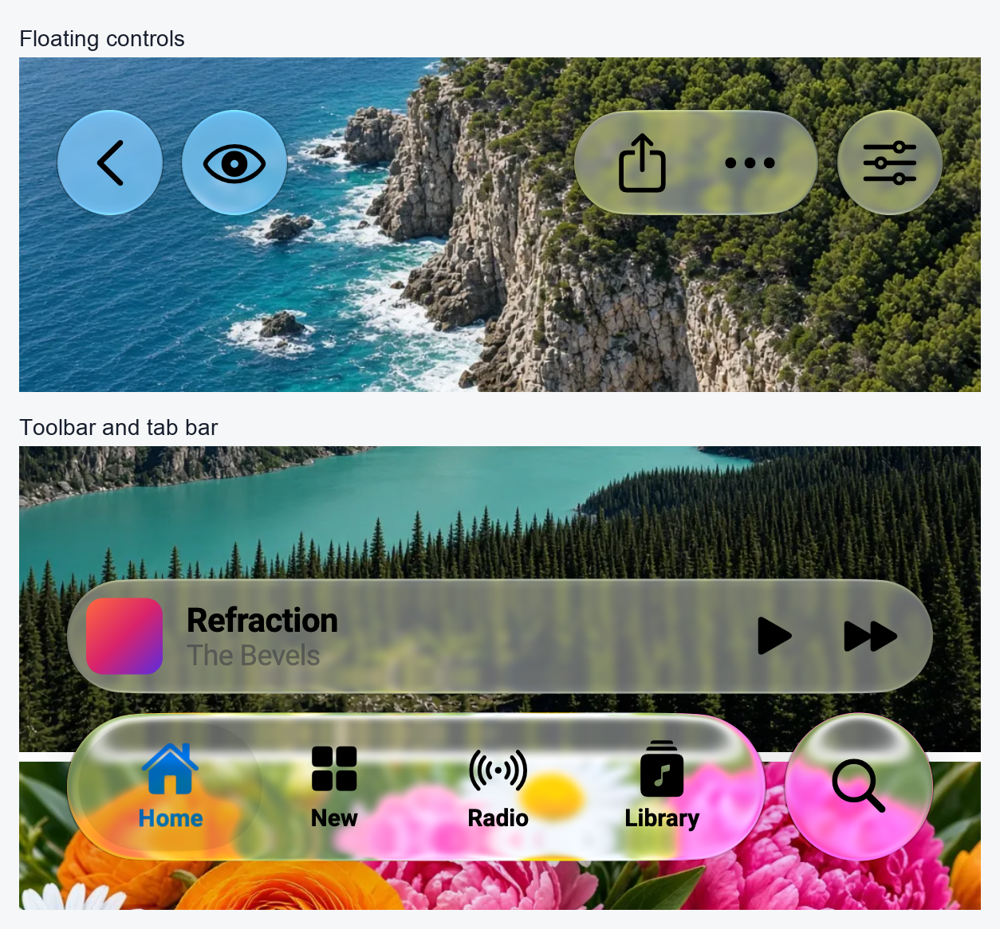
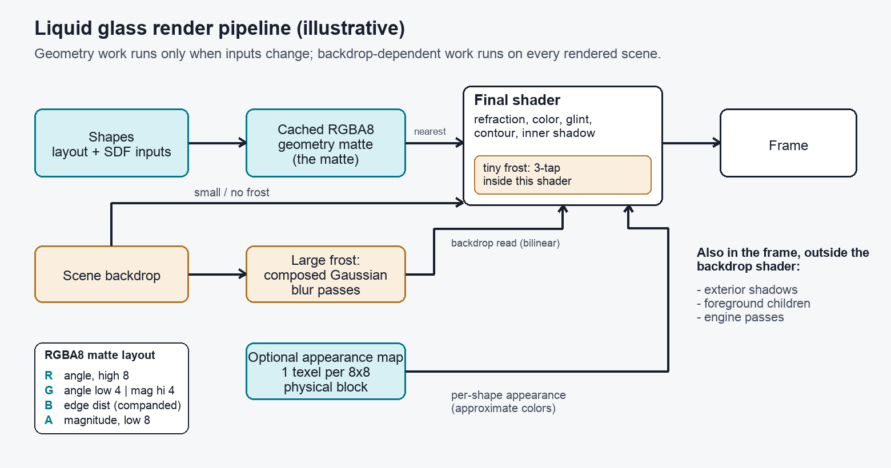
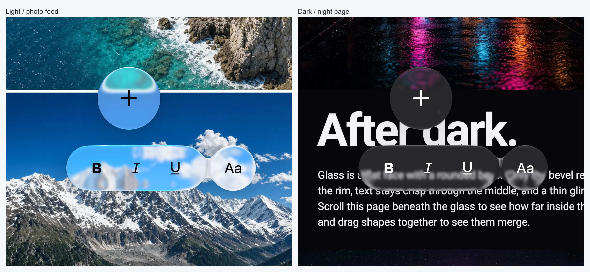
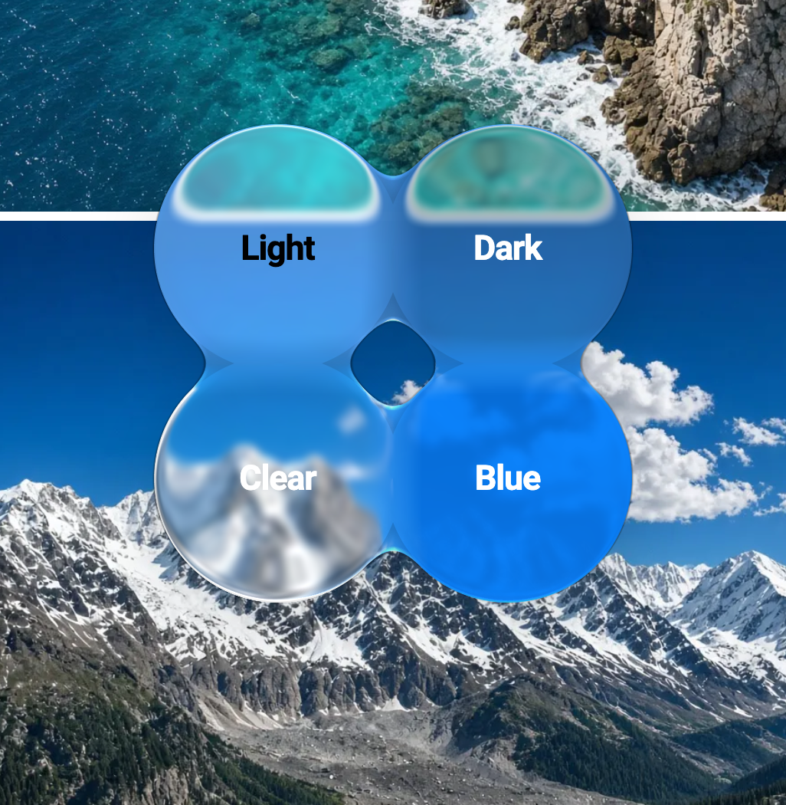
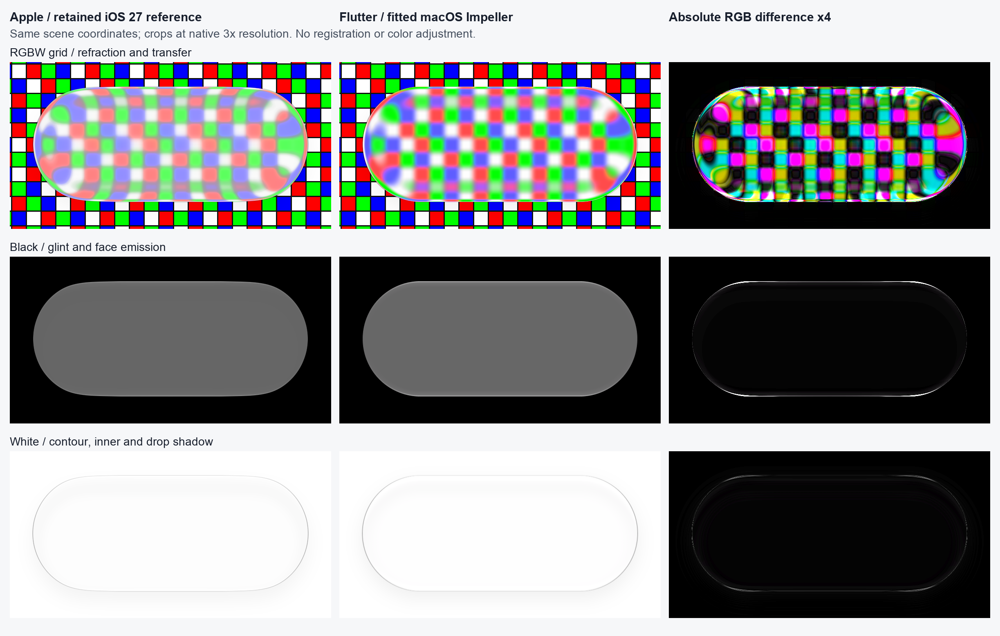
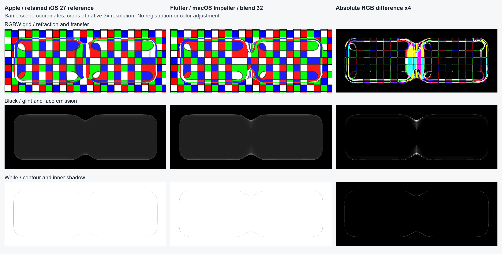
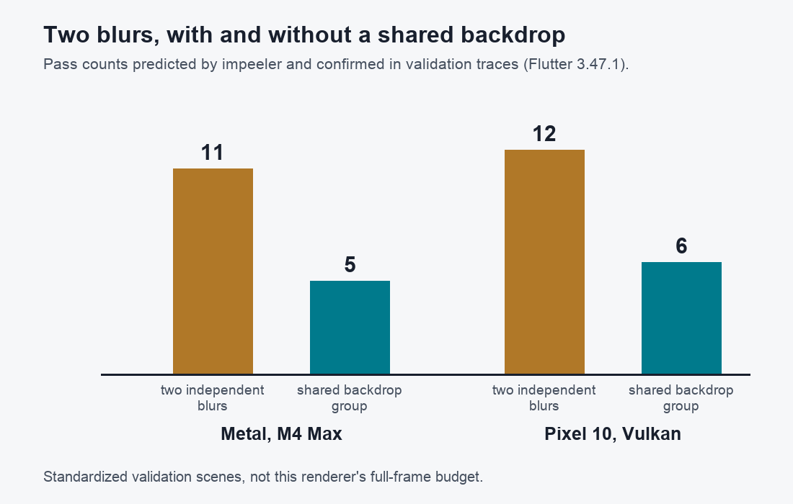
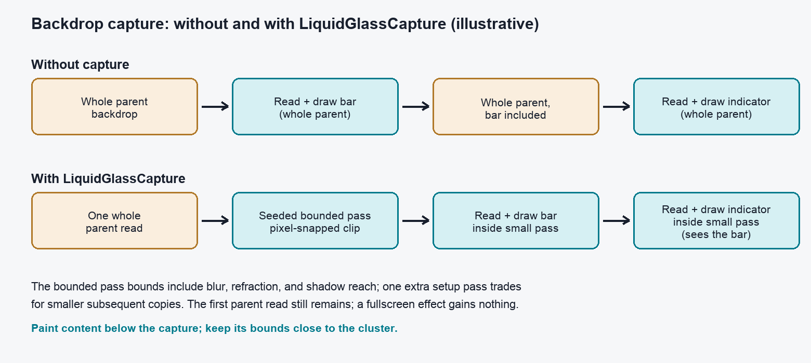
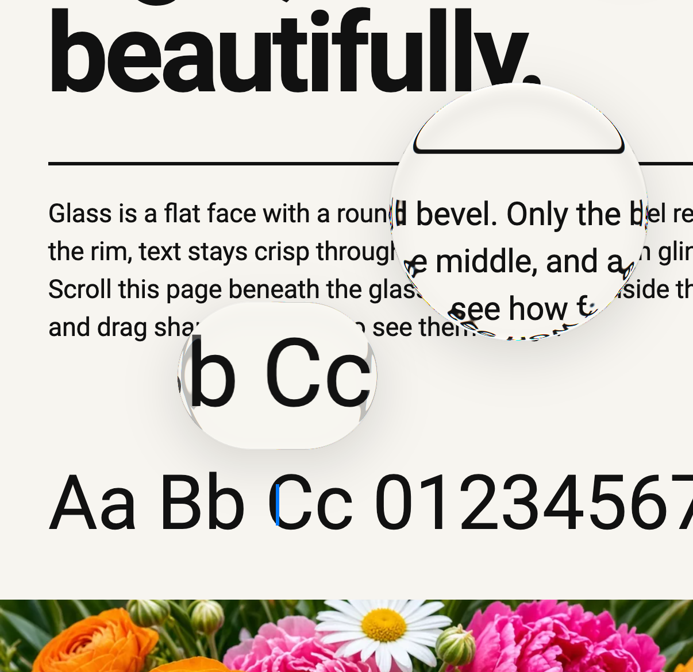

# Rebuilding liquid glass in Flutter

A while back we shipped a small package that paints frosted-glass shapes over
Flutter content. It worked well enough for static widgets, but it had a habit
that kept coming back to bite us: animate a shape — stretch it under a finger,
morph it as a sheet settles — and memory climbed with it. This is the story of
rewriting that pipeline for 1.0: how we stopped replacing geometry textures
on every resize, what those textures encode, and how we learned to
compare our output against Apple's liquid glass without fooling ourselves.

The rewrite covers three things, in the order we will walk through them:
**memory** (where the transient allocations went), **optics** (how much
information we pack into one reused texture, and how we check the result), and
**composition** (how the effect cooperates with the rest of the scene instead
of fighting it).

*Figure 1 — the example’s controls and tab bar over its photo feed, with the renderer’s blurred exterior shadows enabled. These are cropped macOS Impeller host captures at 402×874 logical pixels and 3× scale, using Flutter 3.47.1; Roboto stands in for the system text font. The images are SDR, not physical-phone captures.*

## A geometry texture is a reusable lens

The old pipeline (the 0.2.0-dev series) asked `RenderLiquidGlassGeometry` to
draw each shape with a `PictureRecorder`, run the recording through a shader,
and rasterize it to a fresh `ui.Image` — `Picture.toImageSync` and its
asynchronous sibling both rasterize on the GPU, so this was never a CPU
readback problem. Static geometry was cached; the trouble started when the
geometry actually changed. During a stretch or resize the cache was rebuilt
— potentially every frame — each rebuild producing a new GPU-backed image.
We held each `ui.Image` until its replacement or the renderer's teardown, but
dropping the handle did not determine when the pixels were released: scenes
that had already captured the texture could retain it, and a Dart heap graph
does not account for all native GPU memory. Enough native memory pressure can
cause the OS to terminate an app. Any pipeline in the same family — record a
shape, snapshot it per change — shares that lifetime exposure; our own old
README warned about memory spikes during shape animation.

In 1.0 the geometry pass renders into `flutter_gpu` device-private render
targets, and we wrap the resident GPU texture in a `ui.Image` via
`Texture.asImage` — a shared texture, not a copy. Neither `Texture` nor
`DeviceBuffer` exposes a dispose in Flutter 3.47.1, so instead of fighting
for eager disposal we keep a small ring of textures and reuse them.

What goes into that texture is the interesting part. We call it the *matte*:
it stores signed edge distance together with a precomputed surface-normal
direction and bevel displacement magnitude. The geometry pass computes and
packs these values; the final shader decodes them from one texture lookup
to refract and light the backdrop. The bevel follows a quarter-circle profile
that reaches zero displacement with zero slope on the flat face; shape-fitting keeps
samples from reaching past the center of small regular controls. This is a
fitted lens model, not a full physical simulation — it does not need to be
one to look right. When the geometry inputs are unchanged we reuse the matte;
a scrolling backdrop still runs the final effect on every new scene, without
repeating the per-shape solve.

*Figure 2 — illustrative diagram, not a debug texture and not a performance
count. The tiny-frost path lives inside the final shader; larger frost still
dispatches composed blur passes.*

The supported shapes are circles, ovals, rounded rectangles, and rounded
superellipses; the superellipse math and its parameter table are adapted from
Flutter's Impeller sources (attributed in `third_party`). Shape parameters
are cached on the CPU, per-pixel normals — the surface's outward direction —
are computed analytically rather than through `dFdx`/`dFdy` (which avoids
2×2 block artifacts), and a bounding-box lower bound rejects empty pixels
before the distance solve. When shapes blend, a smooth union weighs in a
blend radius `k` scaled by how much the two surfaces' normals differ —
`k * min(0.5 * length(nA - nB), 1)` — suppressing the swelling you get between
aligned normals while still bridging opposing ones. Figure 4 shows what that
looks like against Apple's rendering of the same scene.

*Merging shapes in the playground’s light and dark appearances, over the photo feed and night page. The drop shadows are rendered by the glass layer, with blur enabled — no shadows were added to the screenshots.*

## Reuse textures through stretch and resize

The ring that replaces per-change allocation is deliberately small: each
output holds the current texture plus up to two retired spares — typically an
alternating pair, at most three textures per output. That is a bound per
output, not a global memory cap. When a shape grows, the backing texture
grows in roughly 1.5× steps, capped at the largest view size in physical
pixels unless a requested size exceeds that. Rendering touches only the active
subrect — the top-left region of the larger texture that holds geometry — with
viewport and scissor set to it, final UVs adjusted so unused capacity is
never sampled, and `LoadAction.dontCare` so nothing is cleared or copied into
the dead region. An earlier exact-size scheme ended up holding many
resolutions at once during a resize; the grow-only ring rides out resize
sweeps.

Ownership is still worth stating precisely: when a texture is replaced we
dispose the renderer-owned `ui.Image` wrapper; the `gpu.Texture` itself stays
subject to GC and native scene lifetime. Reuse is guarded by a frame rule —
a replaced texture waits a scene-submitting frame before it can be written
again. This relies on Flutter 3.47.1's two-frame pipeline and queue ordering;
it is not a general fence or an immutable snapshot API. Each pass uses its
own GPU command buffer on a deferred schedule, and the pre-scene poll flushes
pending submissions even when the layer is retained — the hook does not mark
the layer dirty just to submit. Sharing one command buffer across passes
caused backend issues in our recorded 3.47.1 tests; whether that holds on
other Flutter versions we have not checked.

The historical measurements behind these decisions, recorded 2026-10-01 in
our internal report (section 6.14): four interleaved, thermally gated
repetitions on a Pixel 10 and four rotating rounds on an M4 Max under Metal,
comparing the rewrite (#178, `df1dc46`, reuse off) against the grow-only ring
(#185, `b6105bb`).

| Scenario | Reuse off | Grow-only ring |
|---|---|---|
| Pixel 10, full-width sheet, peak PSS + GPU-reported memory | 647 MB | 321 MB |
| Pixel 10, full-width sheet, CPU-side paint time per frame | 5.32 ms | 1.71 ms |
| M4 Max Metal, large-resize peak footprint | 2119 MB | 610 MB |

These are whole-process numbers under two platform-specific accounting
definitions — PSS (proportional set size) plus GPU-reported memory on
Android, a footprint measure on Metal — not texture bytes, not a
0.2-versus-1.0 comparison, and not a fresh run of current HEAD. GPU cost was
roughly flat on the Pixel sheet (6.30 vs 6.34 megacycles per frame) and the
Metal large-resize GPU-time medians moved up (4.30 vs 4.88 ms per frame) but
the run ranges overlap — possibly a real cost, possibly noise; it needs more
profiling before we call it either way.

## Packing precision where it matters

The matte is a plain RGBA8 texture, and we spend its 32 bits deliberately.
Across R, G, and A we pack a 12-bit normal direction (a diamond-angle
encoding) and a 12-bit displacement magnitude; G carries the low 4 bits of
the angle and the high 4 bits of the magnitude. B holds the edge distance as
an unsigned channel centered on 0.5 — lower codes outside, upper codes
inside — companded with a square-root curve so precision concentrates near
the edge, then inverted with a square on decode. (Companding here just means
nonlinear storage: more codes where they matter.) The motivation is a
back-of-envelope example, not a measurement: at 60 logical pixels of
refraction on a 3× display the displacement spans about 180 physical pixels,
so an 8-bit magnitude quantizes to steps of roughly 180/255 ≈ 0.71 physical
pixels — enough to see a staircase along the bevel — while 12 bits gives
steps around 0.044. One consequence: packed integer fields cannot be
bilinearly interpolated regardless of scaling or transform, so the matte is
always sampled nearest, with UVs mapped into the active subrect. The backdrop
itself is read with bilinear.

Optionally, a low-resolution appearance map stores one texel per 8×8
physical-pixel block plus a few metadata rows. When every shape in a layer
shares its appearance the final shader takes a cheap path with no map;
tint-only variation has a specialized path; and only shapes that genuinely
differ sample the map's contributors and blend weight. Its colors are allowed
to be approximate — the crisp geometry carries the look.

Settings are likewise split: layer-level optics and lighting on one side,
per-shape tint, `colorModel`, and visibility on the other. The adaptive color
model separates luminance, chroma, and tint tone, tunable from Dart uniforms
(`GlassColorParameters`, `GlassColorCurve`, `GlassToneRamp`) rather than
hardcoded constants. The shipped light, dark, clear, and tint presets are
fitted starting points — useful, not universally Apple-correct.

*Four per-shape appearances — Light, Dark, Clear, and Blue — sharing a layer over the photo feed. The background is live Flutter content behind the glass, rather than part of the glass texture.*

## Matching without fooling ourselves

To compare against Apple's rendering we keep shared scene JSON — geometry,
canvas, and probe definitions — that is authoritative for both native SwiftUI
captures and Flutter ones, in a pinned environment: the iOS 27 iPhone 17 Pro
simulator at 402×874 pt at 3×, 8-bit SDR, median of three settled frames, with
accessibility states like Reduce Motion and Reduce Transparency recorded
alongside OS version, appearance, and the settings readback. The references
use public SwiftUI APIs: `.buttonStyle(.glass)` for the toolbar capsule and
`GlassEffectContainer` with `.glassEffect` for merging shapes. Four probes
exercise different failure modes: A is an RGBW (red, green, blue, white) grid
that exposes refraction displacement and color transfer, B a second grid for
checking generalization, C a black backdrop for glint and face emission,
D a white one for absorption and the inner bevel shadow; palette and hue
scenes condition color responses. Fitting runs against staged geometry so
blur or tint cannot quietly compensate for misregistered shapes, and the
pipeline rejects a refraction fit outright if the reference was captured with
Reduce Motion on, since that disables lensing.

*Figure 3 — retained iOS 27 simulator reference (left), macOS Impeller capture with the shipped `ios27Light` material and an explicitly fitted toolbar silhouette and exterior shadow (center), absolute RGB difference amplified ×4 (right), probes A, C, D of `toolbar_capsule`. The capsule is 224×94 pt to match the reference button’s visible bounds; its black drop shadow uses alpha 0.06, blur radius 12 pt, offset (0,6) pt and zero spread. Optics, color response and the 0.036 inner-shadow strength are unchanged. This is a scene-specific host fit, not a new universal shadow default or an iOS-validated replacement. No image registration or color adjustment was applied; the remaining refraction, color and rim differences are visible in the amplified diff.*

*Figure 4 — the same probes for `merge_equal_rects_gap`, with the shipped
`ios27Clear` optics and appearance and a group blend radius calibrated to 32.
Apple's container spacing is 40; those parameters were not treated as
numerically interchangeable. Shape positions, sizes, and corner radii are
unchanged. The bridge contour is closer, while the remaining highlight and
refraction differences are still visible.*

An easy trap was treating SwiftUI's container spacing as numerically
identical to our smooth-union radius. For this scene, copying 40 produced too
much merging. A radius of 32 brought the bridge contour closer while keeping
the shape geometry and material settings fixed. This is a scene-specific
calibration, not a universal conversion factor.

A single aggregate score once hid that we were getting black and white rims
wrong while the mean improved, so we gate regional lighting separately and
inspect nearest-neighbor crops instead of trusting one number; we show the
amplified absolute difference, not a perceptual score. A fast host-side
search on the Mac is a filter only — a promoted winner still has to pass on
the pinned simulator. None of this adds up to a universal fidelity
percentage; it is a regression tool that knows its blind spots.

One limit worth naming: SDR screenshots are not the whole story. A
historical physical-device probe found the surface format was `BGRA10_XR`
while `wantsExtendedDynamicRangeContent` was false — wide gamut alone does
not light the EDR headroom. Our example app now sets the wide-gamut flag and
requests EDR on the `CAMetalLayer` when the scene activates, and a past
report noted the native glint renders brighter on device than in the
simulator. Exact HDR parity is one of the matching limits we have not closed.

## Spend samples only where they help

The final pass is one shared backdrop shader combining refraction, color,
glint, the dark contour, and the inner bevel shadow. Geometry, appearance,
exterior shadows, blur, and engine compositing can still add passes around it.
Pixels outside the matte exit early.

When `abs(dispersion) * maxDisplacement` stays at or below 0.25 physical
pixels, the shader uses one refracted backdrop lookup instead of separate
red, green, and blue lookups. Small frost adds two taps in that branch:
sigma up to 1.25 physical pixels uses a diagonal three-tap approximation,
weighted 0.5 at the center and 0.25 on each side. This stays inside the final
shader instead of dispatching a separate blur. The fitted presets have zero
dispersion and use this path; larger frost still uses a composed Gaussian
blur. The three-tap kernel is an approximation, not an exact Gaussian.

Where the backend supports it, undisplaced reads use `texelFetch` — an exact
texel lookup with no filtering;
the GLES fallback samples at the center with an ordinary texture read.
Source samples are mirrored at the backdrop bounds to avoid black fringes or
stretched edge pixels. The shader cannot recover uncaptured content, so the
capture bounds include the optical reach up front. Fragment
work is clipped to the glass plus its contour support rather than shading
the whole layer uniformly.

## The render pass is often the expensive part

The cost of a blur is not just the blur. On Impeller, `Canvas::FlipBackdrop`
ends the current pass and restores the previous attachment wholesale — a
small clipped blur can still imply a full-attachment copy at the boundaries.
A Gaussian blur is typically a downsample pass plus separate X and Y passes
(optimizations can skip stages, so do not count exactly three), and none of
that shows up in widget or CPU counts.

To see it we built a small dev-dependency tool called **impeeler** that lives
in our talks repository. It records canvas operations for pictures —
including retained ones — reconstructs the display list, then replays the
engine's pass decisions for the pinned Impeller version on a given device,
recognizing scene pushes like `pushClipRect` and `pushBackdropFilter` from
custom layers. It reports pass counts, pass sizes, nominal memory traffic in
bytes, and which widgets caused what, alongside frame demand. The numbers are
a model, not a profiler: shader filters are approximated, direct
`flutter_gpu` work is extra and not automatically tracked, and the output is
nominal bytes rather than measured GPU time — so it does not total this
renderer's full budget either. It has been validated on 14 scenes where its
predictions matched recorded traces on both Metal (M4 Max) and Pixel 10
Vulkan; there is no physical iPhone validation.

*Figure 5 — impeeler's pass counts for two standardized blur validation
scenes on Flutter 3.47.1: two independent blurs versus a shared backdrop
group, 11 vs 5 on Metal and 12 vs 6 on Pixel 10 Vulkan, predicted by the tool
and confirmed in the recorded validation traces. Validation scenes, not this
renderer's full frame.*

Two composition patterns fall out of that. Glass-over-glass needs sequential
independent layers: an indicator lensing the bar it sits on cannot sample an
already-composed layer through a shared `BackdropKey`, because grouping
freezes a common input below both. And `LiquidGlassCapture` wraps a retained,
pixel-snapped clip in an identity-matrix `BackdropFilter`: the whole parent
attachment is read once, a small seeded bounded pass is produced, and nested
layers then copy small regions from it in paint order — so the indicator
really does see the bar. That first full read still happens; capture is not
cropped-read magic, it pays off when several effects cluster tightly, and a
fullscreen layer gains nothing.

*Figure 6 — illustrative schematic, not a numeric pass budget. Without
capture each effect reads the whole parent; with capture, one parent read
seeds a bounded pass that later effects sample sequentially. The bounded pass
bounds include blur, refraction, and shadow reach. Paint content below the
capture and keep its bounds close.*

FakeGlass deserves the same honest accounting rather than a "cheap mode"
label. `ConsolidatedFakeGlassLayer` uses one shared clipped backdrop filter
for compatible, fully visible shapes and paints each surface's own shader —
highlights, shadows — above it. Shapes with saturation/gamma/color-model
overrides or fractional visibility get their own clipped filter, and a shared
`BackdropKey` reuses the common captured source so the transfer is not
compounded. Sharing a capture is not sharing filter work — different filters
still pay their own passes. Fake drops the full GPU geometry, refraction,
and dispersion, but it still pays the same backdrop read and blur, which are
often the dominant costs. If you want the actual low-power alternative, it is
an opaque surface — glass of any kind pays for the scene underneath.

*The text-selection loupe and round magnifier over the playground’s article backdrop, with real blurred shadows. Both magnify content rendered below them.*

## Keeping the scene retained

The layer does one transform poll per frame through the ordinary
`getTransformTo`/`applyPaintTransform` path, which covers scrolling and
boundary motion; the pre-scene hook runs even when the layer is retained, and
nothing forces `alwaysNeedsAddToScene`. A known limitation: a paint-only
`pushTransform` is invisible to the poll. Children are clipped and painted
above the glass, not refracted through it; explicit visibility fades the
optics and refraction with the shape while keeping the child mounted, and
inserting an `Opacity` between the layer and its shapes is unsupported.
Layer-owned shadows keep real and fake glass consistent, and
`LiquidGlass.precache()` warms shader resources before the first glass frame.

On the tooling side, the final-render shaders are compiled by
`hook/build.dart` into `.iplr` bundles for the Impeller backends and kept out
of the pubspec shader list, so the SkSL-compilable FakeGlass path still lets
Skia and web fallbacks build — one reason fake exists at all. The full effect
requires Flutter 3.47 / Dart 3.13 with Impeller, and `flutter_gpu` remains a
preview API. Migration notes in one breath: 1.0 is deliberately breaking —
Glassify, arbitrary shapes, and full child refraction are gone — a layer
supports at most 16 shapes, and the license moved from MIT to Apache 2.0.

The rewrite gives us reusable geometry, a way to inspect optical differences,
and more predictable composition costs. There is still work to do: the
silhouette and merge residuals in Figures 3–4 are visible, and SDR captures
cannot settle the HDR highlights. The memory results are encouraging; GPU
time and power still need checking on the devices an app actually targets.

---

### Source notes

- Geometry renderer and texture ring:
  [`lib/src/internal/flutter_gpu_geometry_renderer_native.dart`](../packages/liquid_glass_renderer/lib/src/internal/flutter_gpu_geometry_renderer_native.dart),
  [`lib/src/rendering/liquid_glass_layer.dart`](../packages/liquid_glass_renderer/lib/src/rendering/liquid_glass_layer.dart),
  [`lib/src/internal/transform_tracking_repaint_boundary_mixin.dart`](../packages/liquid_glass_renderer/lib/src/internal/transform_tracking_repaint_boundary_mixin.dart)
  (pre-scene submission hook, ring bounds, growth rule).
- Matte packing and SDF:
  [`lib/assets/shaders/gpu/displacement_encoding.glsl`](../packages/liquid_glass_renderer/lib/assets/shaders/gpu/displacement_encoding.glsl),
  [`lib/assets/shaders/gpu/sdf.glsl`](../packages/liquid_glass_renderer/lib/assets/shaders/gpu/sdf.glsl),
  [`lib/assets/shaders/liquid_glass_final_render_core.glsl`](../packages/liquid_glass_renderer/lib/assets/shaders/liquid_glass_final_render_core.glsl)
  (`softensInShader`, dispersion fast path).
- Settings and color model:
  [`lib/src/liquid_glass_settings.dart`](../packages/liquid_glass_renderer/lib/src/liquid_glass_settings.dart),
  [`lib/src/liquid_glass_color_model.dart`](../packages/liquid_glass_renderer/lib/src/liquid_glass_color_model.dart)
  (`GlassColorParameters`/`GlassColorCurve`/`GlassToneRamp`).
- Capture and fake composition:
  [`lib/src/liquid_glass_capture.dart`](../packages/liquid_glass_renderer/lib/src/liquid_glass_capture.dart),
  [`lib/src/internal/capture_pass.dart`](../packages/liquid_glass_renderer/lib/src/internal/capture_pass.dart),
  [`lib/src/rendering/consolidated_fake_glass_layer.dart`](../packages/liquid_glass_renderer/lib/src/rendering/consolidated_fake_glass_layer.dart).
- Shader build hook:
  [`hook/build.dart`](../packages/liquid_glass_renderer/hook/build.dart).
- Comparison harness, scenes, presets:
  [`example/tool/apple_match/README.md`](../packages/liquid_glass_renderer/example/tool/apple_match/README.md).
  Historical numbers:
  [`example/tool/results/pixel10-2026-09-30.md`](../packages/liquid_glass_renderer/example/tool/results/pixel10-2026-09-30.md)
  (section 6.14); HDR probe:
  [`example/tool/results/glass-research/glint-hdr-and-inset/report.md`](../packages/liquid_glass_renderer/example/tool/results/glass-research/glint-hdr-and-inset/report.md).
- Engine behavior (pinned 3.47.1): Impeller
  [`canvas.cc`](https://github.com/flutter/flutter/blob/3.47.1/engine/src/flutter/impeller/display_list/canvas.cc)
  and
  [`gaussian_blur_filter_contents.cc`](https://github.com/flutter/flutter/blob/3.47.1/engine/src/flutter/impeller/entity/contents/filters/gaussian_blur_filter_contents.cc);
  the disposal-lifetime context issue
  [flutter/flutter#138627](https://github.com/flutter/flutter/issues/138627)
  is closed — cited as history, not as proof disposal is broken.
- Pass estimation tool: [impeeler](https://github.com/whynotmake-it/talks/tree/f86a0ca/packages/impeeler)
  (talks repository; dev dependency `0.1.0-dev.2` per that branch's README).
- Vendoring note: [liquid_glass_widgets](https://pub.dev/packages/liquid_glass_widgets)
  states on its pub.dev page that its pipeline is vendored from our old
  MIT-licensed renderer; we have not benchmarked its current releases.
