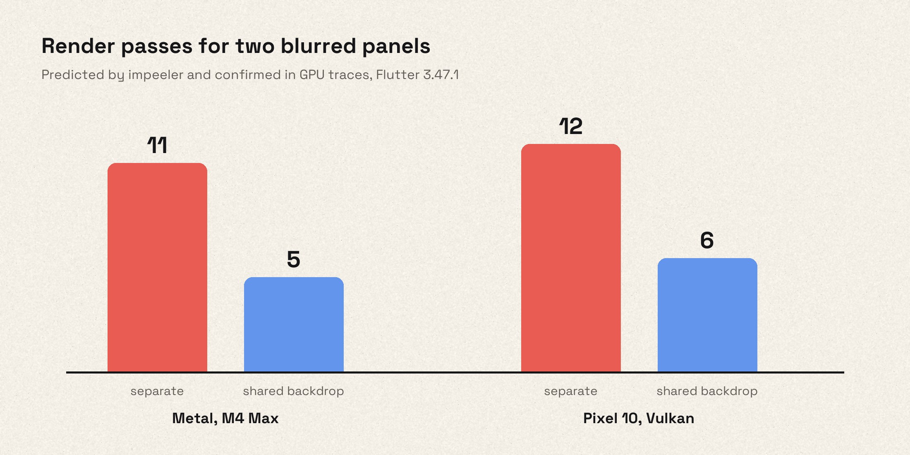

# Rebuilding liquid glass for Flutter

In June 2025, four days after Apple announced Liquid Glass, we published
`liquid_glass_renderer`. It was one of the very first ways to get the effect
in Flutter: shader-based refraction, edges that catch the light, and shapes
that melt into each other when they get close. Its ideas spread.
`liquid_glass_widgets` built its rendering pipeline on our code, and the
renderer will soon be integrated into `cupertino_ui`.

But it never quite looked like Apple's glass. It also had a memory problem:
stretch a button under your finger and memory went up, and resizing a sheet
pushed it higher still.

Today we're releasing `liquid_glass_renderer` 1.0.0-dev.0, the first preview
of 1.0. It's a ground-up rewrite, and as far as we know, the most visually
accurate and best-performing liquid glass implementation in Flutter to date.
Along the way we built three tools: a harness that renders the same scene in SwiftUI
and in Flutter and diffs the two, a benchmark runner that reads a Pixel 10's
power rails, and a tool that predicts Impeller's render passes. This post
covers what those tools taught us. A few of the findings went against what we
expected.

*The example app in light and dark mode. Every screenshot in this post is
rendered by Flutter, at iPhone 17 Pro size.*

## Glass in two halves

Rendering glass involves two kinds of work, and they change at very different
rates.

The first is about the **shape**. How far is this pixel from the edge? Which
way does the surface tilt here, and how far should the background bend? None
of that changes unless the shape moves or resizes.

The second is about the **background**. Whatever sits behind the glass has to
be bent, tinted and lit, and that has to happen again every time the content
underneath changes, which during a scroll means every frame.

1.0 keeps the two apart. The shape work goes into a small texture we call the
*matte*, and the renderer keeps it until a shape changes. Every frame, one
final shader reads the matte, samples the background through it, and adds the
rim highlights, the dark outline and the inner shadow. When a list scrolls
behind a tab bar that isn't moving, the shape work doesn't run at all.

Apple appears to work the same way. Core Animation layer dumps from macOS show
a signed distance field (the same edge-distance data our matte stores) feeding
the backdrop filter, with two highlight layers lit from opposite angles.

### 32 bits per pixel

The matte is an ordinary RGBA8 texture. That's 32 bits per pixel to describe
the lens at that point, and every one of them gets used.

Here's why precision matters. With 60 points of refraction on a 3× screen, the
background can shift by about 180 physical pixels. Store that offset in 8 bits
and each step is 0.7 pixels, which is coarse enough to show up as stair steps
along the curved edge. So the matte packs a 12-bit surface direction and a
12-bit offset into three channels. The fourth stores the distance to the edge,
on a curve that puts most of its precision right at the edge.

Packing values that tightly has a cost: the GPU can't blend neighbouring
pixels. Interpolate between two packed values and you get nonsense, so the
matte is always read pixel by pixel, at full resolution.

We tried half resolution anyway. The golden tests passed, with fewer than 1%
of pixels noticeably off. Then we looked at it on a real screen, and the
rounded corners were clearly wrong. Corners are where the curvature is
highest, so that's where the interpolation errors collect. The statistics had
spread a few concentrated errors across the whole image until they looked
like nothing. Since then, any change to the matte gets checked by eye on a
real display, whatever the tests say.

*Shapes that get close merge through a smooth union. The blend depends on how
differently the two surfaces face, so neighbours form a clean bridge instead
of swelling into a blob.*

## The memory bug that wasn't in Dart

The old pipeline recorded the shapes into a picture and rasterized it into a
brand-new image with `Picture.toImageSync` every time a shape changed. During
a stretch animation, that was one new GPU texture per frame. On the Dart side
everything looked correct, because we dropped each old image as soon as its
replacement arrived.

Dropping the image doesn't free its memory right away, though. The texture
stays alive until the engine is done with it, which can be several frames
later. A sheet-sized matte at 3× is about 8 MB. At 120 frames per second,
those leftover textures add up to hundreds of megabytes while the animation
runs.

Moving to Flutter GPU didn't fix this by itself. A Flutter GPU texture is a
small Dart object wrapping a large native allocation, and the garbage
collector only counts the small object. A matte replaced every frame looks
like a few bytes of garbage to the GC, so it sees no reason to hurry. In one
host test we rendered 1,200 mattes in a row, and 570–700 MB was still
allocated when the loop finished. It was released after a few seconds of
idle time. A phone that's low on memory might kill the app before then.

`liquid_glass_widgets`, which vendors our old pipeline, handles this by
making the textures smaller. While a large shape animates, it renders the
matte at reduced resolution, capped at about one megapixel. When the
animation ends, it renders one more matte at full resolution. That limits
how big each leftover texture gets, but three problems remain:

- **It still allocates a new texture on every frame.** The pile of leftover
  textures is smaller but still there. Our benchmarks showed the allocation
  itself is the expensive part: the UI thread spends milliseconds of every
  frame creating and submitting a texture it throws away one frame later.
- **Low-resolution mattes are wrong at the corners.** We tried this
  ourselves. The matte's values don't change linearly from one pixel to the
  next, so smoothly interpolating a low-resolution matte bends the
  refraction exactly where the curvature is highest.
- **The quality changes when the animation stops.** The glass animates at
  one resolution and comes to rest at another.

Flutter GPU textures have no `dispose()`, so we couldn't free them early
either. 1.0 stops creating them instead: each glass layer keeps a small ring
of textures and draws into the same ones over and over, at full resolution.
That took three attempts.

1. **Plain reuse.** On the Pixel this was a clear win. On the Mac it made
   memory *worse* for anything that kept changing size. Retired textures of
   every size piled up faster than the GC released them, and one large resize
   peaked at 2.4 GB.
2. **Reuse with headroom.** We made each texture a bit bigger than needed, so
   small size changes would fit without a new one. Some scenes improved. A
   full-width sheet resize went from 688 MB to 1,185 MB, because every texture
   the ring replaced was now larger.
3. **Grow-only.** A texture in the ring never shrinks. It grows in steps of
   about 1.5×, and the renderer only draws into the part it needs. A sheet
   moving between 45% and 90% of the screen keeps reusing one large texture
   instead of allocating dozens of different sizes.

The third design shipped. Compared with creating a new texture on every
change:

| Scene | New texture per change | 1.0 (grow-only reuse) |
|---|---:|---:|
| Pixel 10, full-width sheet resize: peak memory | 647 MB | 321 MB |
| Pixel 10, full-width sheet resize: frame rate | 93 fps | 108 fps |
| Pixel 10, three stacked glass layers: frame rate | 70 fps | 119 fps |
| Pixel 10, button stretch: UI-thread paint time | 3.7 ms | 0.9 ms |
| M4 Max, large resize: peak memory | 2,119 MB | 610 MB |

GPU work per frame barely moved, staying within about 2%. The GPU had never
been the bottleneck. The time went to the UI thread, which spent milliseconds
of every frame allocating, encoding and submitting a texture it would throw
away a frame later.

## How we benchmark

A screenshot can't tell you what an effect costs to run. To compare builds
fairly, we built two benchmark runners.

The **Pixel 10** runner installs several builds side by side and alternates
between them, reversing the order each repetition so neither build always
goes first. Before every run it waits until the phone has cooled to a fixed
skin temperature. Each run records a Perfetto trace with power draw in
milliwatts (GPU, CPU and memory, measured separately), GPU cycles per frame,
UI-thread timings and memory use. A second runner on an **M4 Max** records
frame timings, memory footprint and Metal GPU time. Each benchmark scene
isolates one cost: a button stretch, a sheet resize, sixteen shapes merging,
three stacked layers.

Several results surprised us:

- **Higher frame rates can raise power draw.** With texture reuse, scenes
  that used to drop frames hit 120 fps. The phone renders more frames, so
  GPU power goes *up*. The energy per frame went down: 10% less on a button
  stretch and 22% less with three stacked layers. Judged on milliwatts alone,
  the fix would have looked like a regression.
- **A small blur can cost more than a medium one.** Below a sigma of about 4,
  Impeller stops downsampling and blurs at full resolution. On the Pixel, a
  small blur cost more than a sigma-7 blur. 1.0 handles very light frost
  inside the final shader with three texture reads, so it never starts a
  separate blur pass.
- **Shader maths barely mattered.** We tried lower precision, fewer `pow`
  calls and fewer texture reads in the final shader. On the Pixel, power
  draw didn't change. Reading back the screen behind the glass is what costs
  power: about 115 mW for each separate backdrop filter.
- **Clearing a texture cost more than skipping work saved.** One
  optimization limited the shape pass to each shape's bounds and cleared the
  rest of the texture. On a software renderer the output was byte-identical
  and up to 40% faster. On the Pixel the app lost 10 fps, because the clear
  added about 1.5 ms of setup to every frame that redrew the matte. We
  reverted it.
- **Fake glass isn't free either.** `FakeGlass` skips the shape work and the
  refraction, but it still reads the background and blurs it, and those are
  usually the biggest costs. We ran a scripted 54-second session in a real
  production app, covering scrolling, tab switching and opening menus. In the
  old renderer, fake glass was the most expensive setting. In the rewrite it
  draws about a third less power. If you need a fallback that actually saves
  battery, use an opaque surface.

Not every result was clear. Metal GPU timings were sometimes too noisy to
show whether a change helped, and the results files report those as
inconclusive.

## Matching Apple without fooling ourselves

To check whether our glass looks like Apple's, we compare the two directly.

Each test scene is a JSON file that describes the canvas, the glass shapes
and a set of backgrounds. A small SwiftUI app renders the scene with Apple's
public glass APIs (`.buttonStyle(.glass)` and `GlassEffectContainer`) on a
fixed iOS 27 simulator. It saves the median of three settled frames, together
with the OS version, appearance and accessibility settings. A Flutter app
renders the same JSON, and a set of Python scripts compares the two images.

Every scene is rendered over four backgrounds. Each background isolates
different parts of the effect:

- a **colour grid** shows how the glass bends lines and shifts colour;
- a **second grid** checks that a fit still holds on a different pattern;
- **pure black** leaves only the glints and the glow from the surface;
- **pure white** leaves only the outline, the inner shadow and the drop
  shadow.

*An iOS 27 toolbar button and ours, over three of the four backgrounds. The
right column is the plain pixel difference: black where the two match,
brighter where they don't. Nothing was aligned or colour-corrected. Over
black and white only a faint line along the rim remains. Over the colour
grid the difference shows across the whole face. Most of that comes from how
the two blur the background, explained below.*

Rendering a candidate in the simulator is slow, so for everyday tuning we
render our side on macOS instead. A candidate takes 14–20 seconds there, and
its output scores 99.4 out of 100 against the same settings rendered in the
simulator. A candidate that looks better still has to pass in the simulator
before it can change a default.

Lessons from running it:

- **Don't trust a single score.** The first version of our tuning tool
  maximized one weighted score. It picked a candidate that raised the average
  even though the outlines on black and white had clearly got worse. Now each
  region of the image has its own pass threshold, and we inspect zoomed crops
  before trusting any number.
- **Check the accessibility settings.** With Reduce Motion on, iOS turns
  refraction off completely. Tuning refraction against a capture taken that
  way would mean matching an effect that isn't there, so the tool refuses to
  run that tuning.
- **Similar settings aren't the same unit.** SwiftUI's container spacing and
  our blend radius both control how eagerly shapes merge. Setting our radius
  to Apple's spacing of 40 merged them far too much. For this scene, 32 was
  closest. That number only applies to this scene; it isn't a general
  conversion factor.
- **Apple doesn't seem to model a refractive index.** Our first model had
  physical settings: thickness and an index of refraction. Values fitted to
  one control size never worked for another. Fitting the visible edge
  displacement directly, in pixels, does carry across sizes, so the settings
  are now expressed that way.
- **Apple doesn't blur clear glass a little.** For its clearer settings,
  Apple appears to blur the background heavily and then mix that with the
  unblurred background, so it never needs a small blur radius. In Flutter,
  that mix would cost an extra render pass per layer, and we decided against
  it. We blur lightly instead, which looks similar but not the same: the
  grid inside our glass is evenly soft, while Apple's is sharp with a hazy
  veil over it. That accounts for most of the difference you see inside the
  glass in the comparison above.
- **Some settings had no visible effect.** Chromatic dispersion values from
  0 to 0.01 produced byte-identical images in every scene. The shipped
  presets use zero, and when dispersion is too small to see, the shader reads
  the background once instead of three times.

*The neck between two merging rectangles, over black. iOS 27 on the left,
then ours at blend radii from 28 to 40. At 32 the bridge has the same shape;
at Apple's own value of 40 it's far too thick.*

*The full comparison at blend radius 32. Over black and white the two are
nearly indistinguishable. The colour grid shows where we still differ: the
glint in the neck and the way the grid bends inside it.*

We don't publish an "Apple accuracy" percentage, because the pipeline can't
produce a meaningful one. It's a regression tool. It shows whether a change
moved us closer to Apple's rendering or further away, and in which part of
the image. The captures are SDR, so they don't show HDR. On a real iPhone,
the glint along the rim is brighter than SDR white, and we've verified that
ours reaches the same HDR range there. On Android it can't: Flutter renders
into 8-bit surfaces, so the glint stays within SDR.

*Four appearances in one layer. The light, dark, clear and tinted presets
came out of this tuning work. They're starting points, and you can adjust
them from Dart.*

## Render passes cost more than the shader

Much of what glass costs on the GPU happens outside the glass shader. On
Impeller, every backdrop filter ends the current render pass, reads back
everything drawn so far, and starts a new pass. A blur adds passes of its
own. A CPU profiler won't show this, and neither will the widget tree.

To measure it, we built **impeeler**, a small dev tool that records what
Flutter draws and replays Impeller's decisions about where to split render
passes. For each frame it reports how many passes there are, how large they
are, and which widgets caused them. It predicts rather than profiles, but on
14 test scenes its predictions matched real GPU traces on both Metal and the
Pixel.

Two patterns in 1.0 come from those measurements:

- **Share the background where possible.** All glass shapes in one layer
  sample a single shared copy of the background. In the test scene above,
  two blurs sharing one background needed half as many passes as two
  separate blurs.
- **Capture once when glass sits on glass.** A tab bar's selection indicator
  has to refract the bar beneath it, so it can't use the same background copy
  as the bar. `LiquidGlassCapture` reads the screen once into a small, tightly
  cropped area. The bar draws inside it first, then the indicator, which sees
  the finished bar. This only helps when the effects are small and close
  together. A fullscreen layer gains nothing.

*The text-selection loupe and a round magnifier, both magnifying the live
content underneath.*

## What changes for you

1.0 is a breaking release. `Glassify`, arbitrary shapes and child refraction
are gone. The supported shapes are circles, ovals, rounded rectangles and
rounded superellipses, with up to 16 per layer. Children are drawn sharp on
top of the glass instead of being refracted through it. The full effect
needs Flutter 3.47 with Impeller and uses `flutter_gpu`, which is still a
preview API. Skia and web builds fall back to `FakeGlass`. The license
changed from MIT to Apache 2.0.

## What's next

Animating glass no longer uses extra memory. Composition costs are
predictable, and we can measure how far our rendering is from iOS.

That measurement shows work still to do. In the comparison images, the
refraction, the rims and the glint where shapes merge all still differ from
Apple's. Our memory numbers come from
one Pixel and one Mac, so measure GPU time and battery on the devices your
app targets.

1.0.0-dev.0 is a preview, and the API can still change before 1.0. Try it in
your app and tell us what breaks. The scenes, capture scripts and benchmark
runners are all in the repository. If our glass looks clearly wrong in some
situation, the most useful bug report is a scene file that reproduces it.

---

### Source notes

- **Measurements.** The benchmark numbers are from
  [`example/tool/results/pixel10-2026-09-30.md`](../packages/liquid_glass_renderer/example/tool/results/pixel10-2026-09-30.md),
  section 6.14, recorded on 2026-10-01. Four interleaved, thermally gated
  repetitions on a Pixel 10 and four rotating rounds on an M4 Max, comparing
  reuse off (`df1dc46`) with the grow-only ring (`b6105bb`). Pixel memory is
  peak PSS plus GPU-reported memory; Metal memory is peak `phys_footprint`.
  These are whole-process numbers, not texture bytes, and not a fresh run of
  current HEAD. Energy per frame is from section 6.1. The intermediate reuse
  designs are in sections 6.7 and 6.12. The production-app journey is in
  section 6.11 and was measured mid-rewrite. The blur, readback and
  render-target-clear findings are in
  [`optimization-log-2026-09.md`](../packages/liquid_glass_renderer/example/tool/results/optimization-log-2026-09.md)
  (baselines, entries B, K and L). Decisions settled by measurement are
  summarized in [`VALIDATION.md`](VALIDATION.md).
- **Screenshots.** macOS Impeller captures at 402×874 logical pixels and 3×,
  Flutter 3.47.1, SDR, with Roboto standing in for the system font. Drop
  shadows are rendered by the glass layer, not added afterwards. The app
  screenshots come from
  [`example/test/blog_figures_test.dart`](../packages/liquid_glass_renderer/example/test/blog_figures_test.dart)
  The cover's background and ink come from
  [`example/tool/blog_cover.py`](../packages/liquid_glass_renderer/example/tool/blog_cover.py),
  and its glass is rendered over them by
  [`example/test/blog_cover_test.dart`](../packages/liquid_glass_renderer/example/test/blog_cover_test.dart).
  [`example/tool/compose_blog_figures.py`](../packages/liquid_glass_renderer/example/tool/compose_blog_figures.py)
  crops them and adds the frames, rounded corners and labels; the glass
  pixels are not retouched. The phone bezels are scaled down for layout.
- **Comparison figures.** The toolbar figure uses the shipped `ios27Light`
  material, with the capsule held at Apple's visible 224×94 pt bounds and a
  scene-specific drop-shadow fit (black, alpha 0.06, blur 12 pt, offset 0,6).
  That fit is not a new default. The merge figure uses the shipped
  `ios27Clear` material with a blend radius of 32. The difference column is
  the per-channel absolute difference, not amplified. Inputs, settings and
  checksums are in
  [`assets/liquid-glass-rewrite/provenance.json`](assets/liquid-glass-rewrite/provenance.json).
- **Comparison harness.**
  [`example/tool/apple_match/README.md`](../packages/liquid_glass_renderer/example/tool/apple_match/README.md),
  with the scoring history in
  [`results/apple-match-report.md`](../packages/liquid_glass_renderer/example/tool/results/apple-match-report.md)
  and the Core Animation mapping in
  [`apple_match/MODEL_DESIGN.md`](../packages/liquid_glass_renderer/example/tool/apple_match/MODEL_DESIGN.md).
  HDR probe:
  [`glint-hdr-and-inset/report.md`](../packages/liquid_glass_renderer/example/tool/results/glass-research/glint-hdr-and-inset/report.md).
- **Renderer code.** Texture ring:
  [`flutter_gpu_geometry_renderer_native.dart`](../packages/liquid_glass_renderer/lib/src/internal/flutter_gpu_geometry_renderer_native.dart).
  Matte encoding:
  [`displacement_encoding.glsl`](../packages/liquid_glass_renderer/lib/assets/shaders/gpu/displacement_encoding.glsl)
  and [`sdf.glsl`](../packages/liquid_glass_renderer/lib/assets/shaders/gpu/sdf.glsl).
  Final shader:
  [`liquid_glass_final_render_core.glsl`](../packages/liquid_glass_renderer/lib/assets/shaders/liquid_glass_final_render_core.glsl).
  Capture:
  [`liquid_glass_capture.dart`](../packages/liquid_glass_renderer/lib/src/liquid_glass_capture.dart).
  The superellipse math is adapted from Impeller, attributed in `third_party`.
- **Engine behaviour** (pinned to Flutter 3.47.1): Impeller's
  [`canvas.cc`](https://github.com/flutter/flutter/blob/3.47.1/engine/src/flutter/impeller/display_list/canvas.cc)
  and
  [`gaussian_blur_filter_contents.cc`](https://github.com/flutter/flutter/blob/3.47.1/engine/src/flutter/impeller/entity/contents/filters/gaussian_blur_filter_contents.cc).
- **impeeler:** [talks repository](https://github.com/whynotmake-it/talks/tree/f86a0ca/packages/impeeler).
  Validated on Metal (M4 Max) and Pixel 10 Vulkan; not validated on a
  physical iPhone.
- **Vendoring note:** [liquid_glass_widgets](https://pub.dev/packages/liquid_glass_widgets)
  states that its pipeline is vendored from our old MIT-licensed renderer
  (baseline 0.2.0-dev.4, per its `lib/src/engine/ATTRIBUTION.md`). The
  animating-matte cap is `_kAnimatingMattePixelBudget` and
  `_matteDevicePixelRatio` in its
  [`liquid_glass_render_object.dart`](https://github.com/sdegenaar/liquid_glass_widgets/blob/414000e/lib/src/engine/rendering/liquid_glass_render_object.dart),
  read at commit `414000e` (1.13.0). We have not benchmarked its current
  releases. Our corner-artifact finding comes from our own half-resolution
  experiment
  ([`optimization-log-2026-09.md`](../packages/liquid_glass_renderer/example/tool/results/optimization-log-2026-09.md),
  entry B), not from testing their package.
- **Release date:** `liquid_glass_renderer` was first published on
  2025-06-13, four days after Apple announced Liquid Glass at WWDC on
  2025-06-09.
