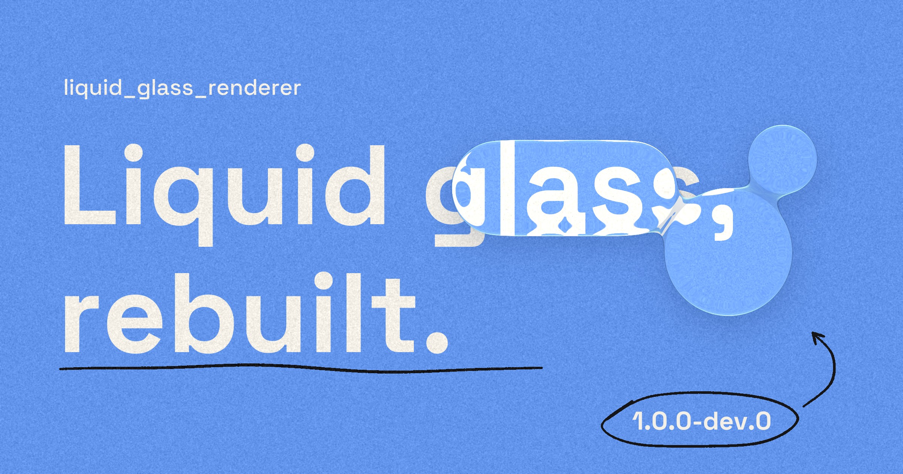
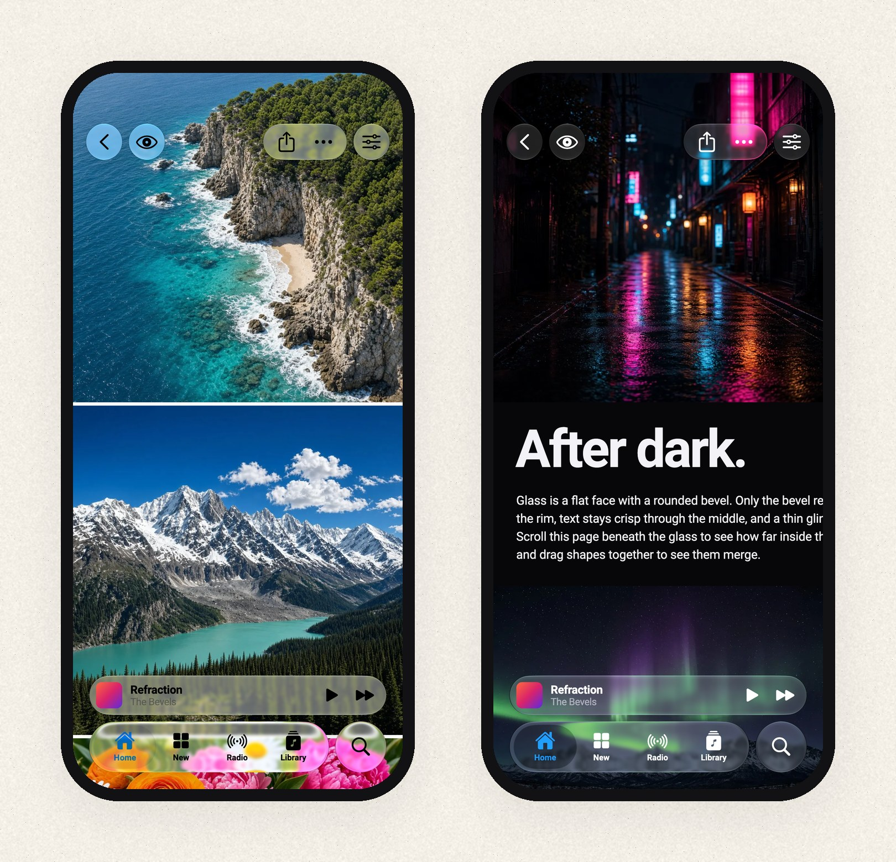
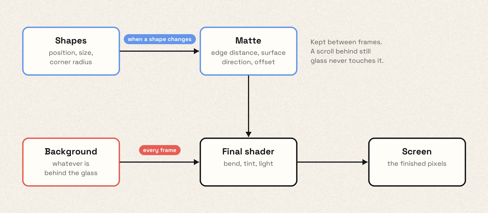
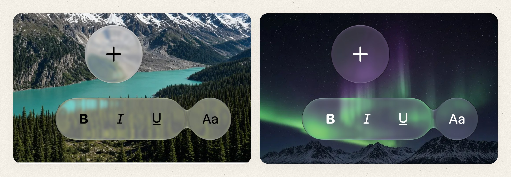
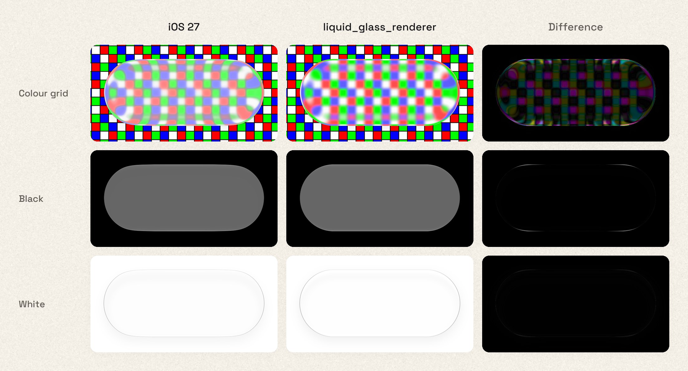
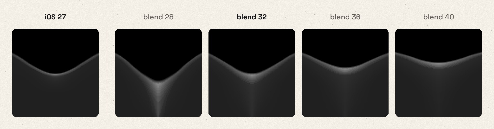
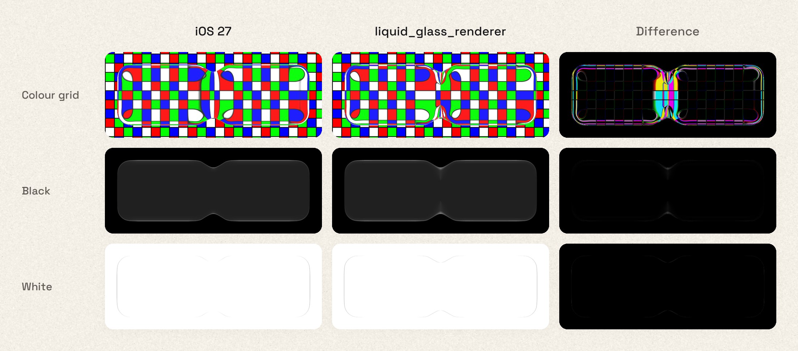
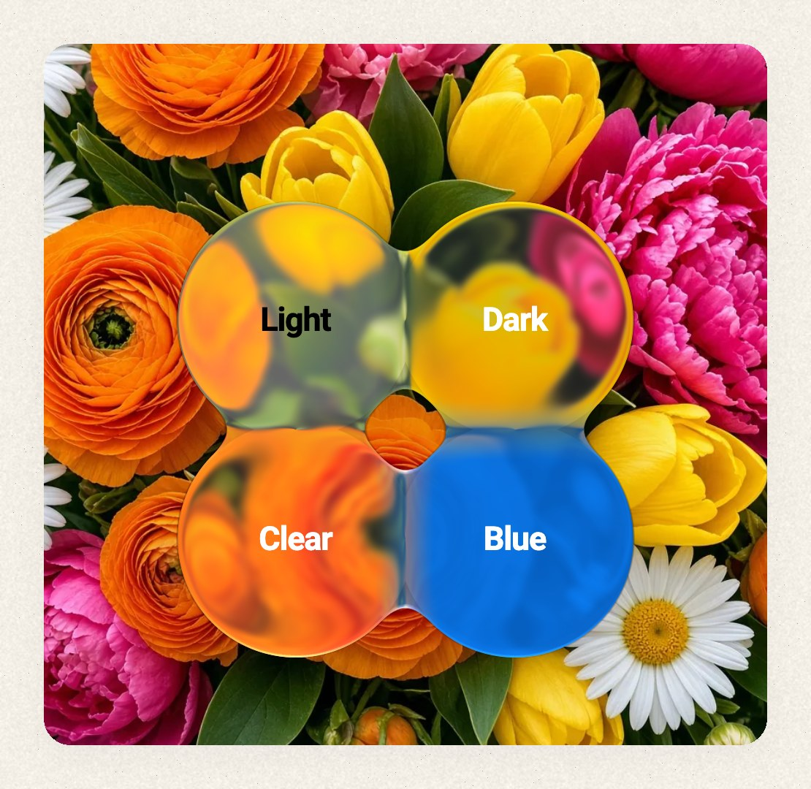
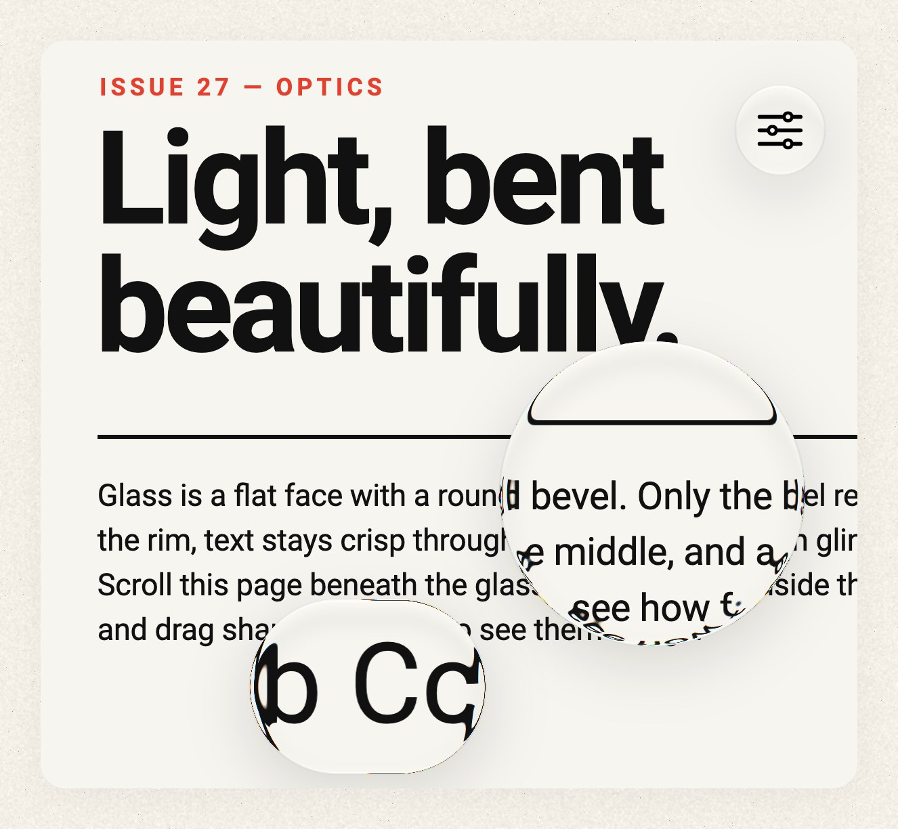

# Rebuilding liquid glass for Flutter: a first preview

In June 2025, four days after Apple announced Liquid Glass, we published
`liquid_glass_renderer`. It was one of the very first ways to get the effect
in Flutter: shader-based refraction, edges that catch the light, and shapes
that melt into each other when they get close, all based on widgets you can
insert into your tree as you wish. Its ideas spread.
`liquid_glass_widgets` built its rendering pipeline on our code, and the
renderer will soon be integrated into `cupertino_ui`.

But it never quite looked like Apple's glass. It also had a memory problem:
stretch a button under your finger and memory went up, and resizing a sheet
pushed it higher still. These spikes could get so bad that the OS would kill
your app for memory pressure. That happened to us in our own production app.

Today we're releasing `liquid_glass_renderer` 1.0.0-dev.0, the first preview
of 1.0. It's a ground-up rewrite, and to the best of our knowledge it's the
most visually accurate and fastest liquid glass implementation in Flutter
today. In our benchmarks it is much faster and far lighter on memory in the
scenes that used to hurt the most.
Unlike the previous versions, this one is meant to grow into a stable 1.0.

**This is a preview, and we're asking for help.** We're app developers, not
GPU engineers. Everything below was measured on one Pixel 10 and one M4 Max,
with spot checks on an iPhone 15, so we'd love to hear how it runs on yours. And if you know your
way around Impeller, Metal, Vulkan or mobile GPUs, we'd love for you to tell
us where we're wrong. There's a list of open questions at the end.

Along the way we built three tools: a harness that renders the same scene in
SwiftUI and in Flutter and diffs the two, a benchmark runner that reads a
Pixel 10's power rails, and a tool that predicts Impeller's render passes.
This post shares what those tools taught us, including a few things that
surprised us. Treat it as notes from people learning in public, not as
authoritative engine documentation.

*The example app in light and dark mode. Every screenshot of our glass in
this post is rendered by Flutter, at iPhone 17 Pro size.*

## On liquid glass in Flutter

A disclaimer first: on iOS, we think the best way to get Liquid Glass in
Flutter is Apple's own glass in a platform view. Apple renders it with access
to the OS we'll never have, and it follows every retune for free. Platform
views [still have costs](https://github.com/flutter/flutter/issues/190815),
but those are worth fixing in the engine rather than chasing a moving target
in shaders.

We built this anyway because it pushes what Flutter can do and exposes what's
missing, it works on every platform, and it lets you create looks Apple's API
doesn't offer.

## Glass in two halves

Rendering glass involves two kinds of work, and they change at very different
rates.

The first is about the **shape**. How far is this pixel from the edge? Which
way does the surface tilt here, and how far should the background bend? None
of that changes unless the shape changes or resizes.

The second is about the **background**. Whatever sits behind the glass has to
be bent, tinted and lit, and that has to happen again every time the content
underneath changes, which during a scroll means every frame.

1.0 keeps the two apart. The shape work goes into a small texture we call the
*matte*, and the renderer keeps it until a shape changes. Every frame, one
final shader reads the matte, samples the background through it, and adds the
rim highlights, the dark outline and the inner shadow. When a list scrolls
behind a tab bar that isn't moving, the shape work doesn't run at all.

### 32 bits per pixel

The matte is an ordinary RGBA8 texture. That's 32 bits per pixel to describe
the lens at that point.

Here's why precision matters. With 60 points of refraction on a 3× screen, the
background can shift by up to about 180 physical pixels. Store that offset in
8 bits and each step is 0.7 pixels, which is coarse enough to show up as
stair steps along the curved edge. So the matte packs a 12-bit surface
direction and a 12-bit offset into three channels. The remaining channel
stores the distance to the edge, on a curve that puts most of its precision
right at the edge.

That packing has a downside we haven't solved: the values can't be smoothly
interpolated, so the matte has to be rendered and read at full resolution.
We suspect a smarter format exists. If you've built something like this,
we'd like to hear about it.

*Shapes that get close merge through a smooth union. The blend depends on how
differently the two surfaces face, so neighbours form a clean bridge instead
of swelling into a blob.*

## The memory bug that wasn't in Dart

The old pipeline recorded the shapes into a picture and rasterized it into a
brand-new image with `Picture.toImageSync` every time a shape changed. During
a stretch animation, that was one new GPU texture per frame. We disposed each
old image as soon as its replacement arrived, so on the Dart side everything
looked correct.

But disposing an image doesn't free its memory right away. The engine
defers releasing the texture to a later point, after the frames that might
still use it are done. A sheet-sized matte at 3× is roughly 8–12 MB. At 120
frames per second, those not-yet-freed textures add up to hundreds of
megabytes while the animation runs.

Moving to Flutter GPU didn't fix this by itself. A Flutter GPU texture is a
small Dart object wrapping a large native allocation, it only reports the
size of the small wrapper to the GC, and it has no `dispose()`. A matte
replaced every frame looks like a few bytes of garbage. In one test on a
Linux host we rendered 1,200 small mattes in a row, and 570–700 MB was still
allocated when the loop finished. It was released after a few seconds of
idle time.

`liquid_glass_widgets`, which vendors our old pipeline, limits the damage by
rendering the matte at reduced resolution while a large shape animates, and
at full resolution once it comes to rest. That's a sensible way to cap how
big each leftover texture gets, but it still creates a new texture on every
frame, and the glass changes quality when the animation stops. We tried
lowering the matte resolution in our own renderer too, but with our matte
format the interpolation errors showed up as visibly wrong refraction at the
corners, where the curvature is highest.

We went the other way: stop creating textures. Each glass layer reuses its
textures and draws into the same ones over and over, at full resolution. That
took three attempts.

1. **Plain reuse.** On the Pixel this fixed frame rate and UI-thread time. On
   the Mac, scenes that kept changing size got *worse*: retired textures of
   every size piled up faster than the GC released them, and our largest
   resize scene peaked at 2.4 GB, against 2.1 GB without reuse.
2. **Reuse with headroom.** We made each texture a bit bigger than needed, so
   small size changes would fit without a new one. Some scenes improved. On
   the Mac, a full-width sheet resize went from 688 MB to 1,185 MB, because
   every texture that got replaced was now larger.
3. **Grow-only.** A texture never shrinks while its layer lives. It grows in
   steps of about 1.5×, and the renderer only draws into the part it needs.
   A sheet moving between 45% and 90% of the screen keeps reusing one large
   texture instead of allocating dozens of different sizes.

The third design shipped. Compared with creating a new texture on every
change (measured on the grow-only build from the end of September; the
texture cache has been simplified since, and we haven't re-run the full
suite on it yet):

| Scene | New texture per change | Grow-only reuse |
|---|---:|---:|
| Pixel 10, full-width sheet resize: peak memory | 647 MB | 321 MB |
| Pixel 10, full-width sheet resize: frame rate | 93 fps | 108 fps |
| Pixel 10, three stacked glass layers: frame rate | 70 fps | 119 fps |
| Pixel 10, button stretch: UI-thread paint time | 3.7 ms | 0.9 ms |
| M4 Max, large resize: peak memory | 2,119 MB | 610 MB |

These are whole-process numbers. The M4 Max row is our best case; on the
other Mac scenes, peak memory dropped by between 0 and 20%.

## How we benchmark

A screenshot can't tell you what an effect costs to run. To compare builds
fairly, we built two benchmark runners.

The **Pixel 10** runner installs several builds side by side and alternates
between them, reversing the order each repetition so neither build always
goes first. Before every run it waits until the phone has cooled to a fixed
skin temperature. Each run records a Perfetto trace with power draw in
milliwatts (GPU, CPU and memory, measured separately), GPU cycles per frame,
UI-thread timings and memory use. A second runner on an **M4 Max** records
frame timings, memory footprint and Metal GPU time. Each benchmark scene
isolates one cost: a button stretch, a sheet resize, sixteen shapes merging,
three stacked layers.

Some things we learned, with the caveat that all power numbers come from a
single phone:

- **Higher frame rates can raise power draw.** With texture reuse, scenes
  that used to drop frames hit 120 fps. The phone renders more frames, so
  GPU power goes *up*. Per frame, the whole chip (GPU, CPU and memory
  together) used about 8% less energy on a button stretch and 20% less with
  three stacked layers. GPU energy per frame alone actually rose slightly.
  Judged on GPU milliwatts alone, the fix would have looked like a
  regression.
- **Blur cost isn't proportional to blur size.** Impeller picks a
  power-of-two downsample factor from the blur's size in *device* pixels,
  and the kernel ends up roughly the same width at each factor. Very small
  blurs, below roughly 5–6 device pixels, run at full resolution. So a blur
  just below one of those boundaries can shade several times more pixels
  than a noticeably larger one. That matches something we noticed on the
  Pixel, where a sigma-4 blur (half resolution there) cost more than a
  sigma-7 blur (quarter resolution), though we didn't record a careful A/B.
  So the presets nudge very light frost up to just past that point for the
  screen they're running on. A frost value you set yourself is left alone.
- **Shader arithmetic tweaks didn't move power.** Lower precision, fewer
  `pow` calls and fewer texture reads in the final shader made no measurable
  difference on the Pixel. What does cost power is moving pixels around:
  every separate backdrop filter cost about 115 mW of GPU power on the
  Pixel, and the full-resolution final pass costs roughly as much again. That
  doesn't mean the shader is free, just that micro-optimizing its maths
  wasn't where the cost was.
- **Fake glass isn't free either.** `FakeGlass` skips the shape work and the
  refraction, but it still reads the background and blurs it, and those are
  usually the biggest costs. In a scripted 54-second session in a real
  production app (scrolling, tab switching, opening menus), the rewrite's
  fake glass drew about a third less power than the old renderer's, but
  only about 13% less than the rewrite's real glass. If you need a fallback
  that actually saves battery, use an opaque surface.

Not every result was clear. Metal GPU timings were sometimes too noisy to
show whether a change helped, and the results files report those as
inconclusive.

## Matching Apple without fooling ourselves

To check whether our glass looks like Apple's, we compare the two directly.

Each test scene is a JSON file that describes the canvas, the glass shapes
and a set of backgrounds. A small SwiftUI app renders the scene with Apple's
public glass APIs (`.buttonStyle(.glass)` and `GlassEffectContainer`) on a
fixed iOS 27 simulator. It saves the median of three settled frames, together
with the OS version, appearance and accessibility settings. A Flutter app
renders the same JSON, and a set of Python scripts compares the two images.

Every scene is rendered over four backgrounds. Each background isolates
different parts of the effect:

- a **colour grid** shows how the glass bends lines and shifts colour;
- a **second grid** checks that a fit still holds on a different pattern;
- **pure black** leaves only the glints and the glow from the surface;
- **pure white** leaves only the outline, the inner shadow and the drop
  shadow.

*An iOS 27 toolbar button (simulator) and ours, over three of the four
backgrounds. The right column is the plain pixel difference: black where the
two match, brighter where they don't. We sized our capsule to Apple's visible
bounds and fitted the drop shadow for this scene, but didn't align or
colour-correct anything after rendering. Over black and white only a faint
line along the rim remains. Over the colour grid the difference shows across
the whole face. Much of that seems to come from how the two blur the
background: Apple appears to mix a heavily blurred copy with a sharp one,
while we apply one light blur. Some colour differences remain too, which we
hope to iron out before 1.0.0.*

*The neck between two merging rectangles, over black. iOS 27 on the left,
then ours at blend radii from 28 to 40. At 32 the bridge has the same shape.
At 40, the container spacing used in our SwiftUI scene, it's far too thick:
the two numbers control similar things but aren't the same unit.*

*The full comparison at blend radius 32. Over black and white the two are
nearly indistinguishable. The colour grid shows where we still differ: the
glint in the neck and the way the grid bends inside it.*

We don't publish an "Apple accuracy" percentage, because the pipeline can't
produce a meaningful one. It's a regression tool. It shows whether a change
moved us closer to Apple's rendering or further away, and in which part of
the image.

The captures are SDR, so they don't show HDR. On a real iPhone, Apple's glint
along the rim is brighter than SDR white. Ours can be too, but Flutter
doesn't ask iOS for that extended brightness range by default, so you need
to opt in: set `FLTEnableWideGamut` in `Info.plist`, and set
`wantsExtendedDynamicRangeContent` on the Flutter view's `CAMetalLayer` in
your app delegate. The README and the example app show both. On Android,
Flutter renders into 8-bit surfaces, so the glint stays within SDR.

*Four appearances in one layer. The light, dark, clear and tinted presets
came out of this tuning work. They're starting points, and you can adjust
them from Dart.*

## Render passes cost more than the shader

Much of what glass costs on the GPU happens outside the glass shader. On
Impeller, a backdrop filter splits the current render pass: what has been
drawn so far is stored to a texture, a new pass starts, and that texture is
drawn back in as its starting point, all on the GPU. Any backdrop filter also
makes the frame render offscreen and get copied to the screen at the end. A
blur then adds passes of its own. A CPU profiler won't show any of this, and
neither will the widget tree.

To understand it, we built [**impeeler**](https://pub.dev/packages/impeeler),
a small dev tool that records what Flutter draws and replays Impeller's
decisions about where to split render passes. For each frame it reports how
many passes there are, how large they are, and which widgets caused them. It
predicts rather than profiles. On 14 small test scenes, its predicted pass
structure matched real GPU traces on both Metal and the Pixel. It doesn't
predict cost, and we haven't validated it on a physical iPhone.

Two patterns in 1.0 come from those measurements:

- **Share the background where possible.** All glass shapes in one layer
  sample a single shared copy of the background. Separate layers can share
  too, through Flutter's `BackdropGroup`, which is opt-in. In impeeler's
  test scenes, two identical blurs sharing one background took 5 passes
  instead of 11.
- **Capture once when glass sits on glass.** A tab bar's selection indicator
  has to refract the bar beneath it, so it can't use the same background copy
  as the bar. `LiquidGlassCapture` pays for one full split, copies the
  background into a small, tightly cropped pass, and lets the glass inside
  split only that small pass. The bar draws first, then the indicator, which
  sees the finished bar. This helped in our example app (about 17% less GPU
  power) but barely moved the needle in a production app, and it only helps
  when the effects are small and close together.

*The text-selection loupe and a round magnifier, both magnifying the live
content underneath.*

## What changes for you

1.0 is a breaking release. `Glassify`, arbitrary shapes and child refraction
are gone. The supported shapes are circles, ovals, rounded rectangles and
rounded superellipses, currently up to 16 per layer. Children are drawn sharp
on top of the glass instead of being refracted through it.

The full effect needs Flutter 3.47 with Impeller, and uses `flutter_gpu`,
which is still a preview API that you have to enable: pass
`--enable-flutter-gpu` to `flutter run`, or set `FLTEnableFlutterGPU` in
`Info.plist` and the `EnableFlutterGPU` meta-data in `AndroidManifest.xml`
(details in the README). Without it, and on Skia and web builds, the package
falls back to `FakeGlass`. The license changed from MIT to Apache 2.0.

## Where we'd love your help

Animating glass no longer piles up a texture per frame, composition costs
are more predictable, and we can measure how far our rendering is from iOS.
That measurement also shows how much is left. The refraction, the colour
transfer, the rims and the glint where shapes merge all still differ from
Apple's.

**Please test it on your devices.** Our numbers come from one Pixel 10
(PowerVR), one M4 Max and an iPhone 15. We have no data from Mali or Adreno
GPUs, older iPhones, or low-memory devices. If the glass stutters, drains
battery, or looks clearly wrong, please open an issue. The most useful
reports include the device, a short screen recording, and ideally a scene
file that reproduces it. The scenes, capture scripts and benchmark runners
are all in the repository.

**If you know GPUs, please tell us what we're missing.** Some questions we
couldn't answer ourselves:

- **Blur.** Apple seems to mix a heavily blurred background with a sharp
  one. In Flutter that costs an extra backdrop pass per layer. Is there a
  cheaper way to get that look, or a better blur strategy altogether?
- **The matte format.** Our packed RGBA8 matte forces full resolution. Would
  a linear distance field at lower precision or half resolution, with the
  rest derived in the final pass, hold up at the corners?
- **Render passes on tile-based GPUs.** Backdrop filters dominate our power
  numbers, and the Pixel's GPU doesn't get Impeller's framebuffer-fetch path.
  How much of what we measured carries over to other phones?
- **Anything else.** If something in this post is wrong, we'd rather hear it
  from you than keep repeating it.

1.0.0-dev.0 is a preview, and the API can still change before 1.0. Try it in
your app, tell us what breaks, and help us make it faster.

---

### Source notes

- **Measurements.** The benchmark table and energy-per-frame figures are from
  [`example/tool/results/pixel10-2026-09-30.md`](../packages/liquid_glass_renderer/example/tool/results/pixel10-2026-09-30.md),
  section 6.14, recorded on 2026-10-01. Four interleaved, thermally gated
  repetitions on a Pixel 10 and four rotating rounds on an M4 Max, comparing
  reuse off (`df1dc46`) with the grow-only ring (`b6105bb`). Pixel memory is
  peak PSS plus GPU-reported memory; Metal memory is peak `phys_footprint`.
  These are whole-process numbers, not texture bytes, and not a fresh run of
  current HEAD (the cache was simplified in #226). Reuse-off peak memory for
  the sheet scene varied between 611 and 816 MB across sessions. Energy per
  frame is SoC power (GPU, GPU memory, CPU and DDR rails; display excluded)
  divided by frame rate: button stretch 803/104.8 → 849/120.5 mJ, three
  layers 1194/70.0 → 1618/119.2 mJ. The intermediate reuse designs are in
  sections 6.12 and 6.14 (the 2.4 GB figure is arm B of 6.14). The
  production-app journey is in section 6.11 (n = 2, measured mid-rewrite,
  with a different glass integration in the old and new app builds). The
  blur, readback and shader-maths findings are in
  [`performance-audit.md`](../packages/liquid_glass_renderer/example/tool/results/performance-audit.md)
  and
  [`optimization-log-2026-09.md`](../packages/liquid_glass_renderer/example/tool/results/optimization-log-2026-09.md)
  (baselines, entries B, I, J and L). The sigma-4 vs sigma-7 observation is
  recorded only as prose, without power numbers. The host GC test (entry L) used a
  320×320 matte on Linux with SwiftShader. Decisions settled by measurement
  are summarized in [`VALIDATION.md`](VALIDATION.md).
- **Old-renderer memory.** The old renderer disposed each matte image
  (`render_liquid_glass_geometry.dart` at `liquid_glass_renderer-v0.2.0-dev.4`).
  The out-of-memory kills were observed in our production app with the old
  renderer enabled.
- **Screenshots.** macOS Impeller captures at 402×874 logical pixels and 3×,
  Flutter 3.47.1, SDR, with Roboto standing in for the system font. Drop
  shadows are rendered by the glass layer, not added afterwards. The app
  screenshots come from
  [`example/test/blog_figures_test.dart`](../packages/liquid_glass_renderer/example/test/blog_figures_test.dart).
  The cover's background and ink come from
  [`example/tool/blog_cover.py`](../packages/liquid_glass_renderer/example/tool/blog_cover.py),
  and its glass is rendered over them by
  [`example/test/blog_cover_test.dart`](../packages/liquid_glass_renderer/example/test/blog_cover_test.dart).
  [`example/tool/compose_blog_figures.py`](../packages/liquid_glass_renderer/example/tool/compose_blog_figures.py)
  crops them and adds the frames, rounded corners and labels; the glass
  pixels are not retouched. The phone bezels are scaled down for layout.
- **Comparison figures.** Apple captures come from the iOS 27 simulator. The
  toolbar figure uses the shipped `ios27Light` material, with the capsule
  held at Apple's visible 224×94 pt bounds and a scene-specific drop-shadow
  fit (black, alpha 0.06, blur 12 pt, offset 0,6). That fit is not a new
  default. The merge figure uses the shipped `ios27Clear` material with a
  blend radius of 32; the SwiftUI scene uses a container spacing of 40. The
  difference column is the per-channel absolute difference, not amplified.
  Inputs, settings and checksums are in
  [`assets/liquid-glass-rewrite/provenance.json`](assets/liquid-glass-rewrite/provenance.json).
- **Comparison harness.**
  [`example/tool/apple_match/README.md`](../packages/liquid_glass_renderer/example/tool/apple_match/README.md),
  with the scoring history in
  [`results/apple-match-report.md`](../packages/liquid_glass_renderer/example/tool/results/apple-match-report.md)
  and the Core Animation mapping in
  [`apple_match/MODEL_DESIGN.md`](../packages/liquid_glass_renderer/example/tool/apple_match/MODEL_DESIGN.md).
  HDR setup: the README's HDR section and the probe (iPhone 15, iOS 27):
  [`glint-hdr-and-inset/report.md`](../packages/liquid_glass_renderer/example/tool/results/glass-research/glint-hdr-and-inset/report.md).
- **Renderer code.** Texture cache:
  [`flutter_gpu_geometry_renderer_native.dart`](../packages/liquid_glass_renderer/lib/src/internal/flutter_gpu_geometry_renderer_native.dart).
  Matte encoding:
  [`displacement_encoding.glsl`](../packages/liquid_glass_renderer/lib/assets/shaders/gpu/displacement_encoding.glsl)
  and [`sdf.glsl`](../packages/liquid_glass_renderer/lib/assets/shaders/gpu/sdf.glsl).
  Final shader:
  [`liquid_glass_final_render_core.glsl`](../packages/liquid_glass_renderer/lib/assets/shaders/liquid_glass_final_render_core.glsl).
  Capture:
  [`liquid_glass_capture.dart`](../packages/liquid_glass_renderer/lib/src/liquid_glass_capture.dart).
  The superellipse math is adapted from Impeller, attributed in `third_party`.
- **Engine behaviour** (pinned to Flutter 3.47.1): backdrop pass splits in
  Impeller's
  [`canvas.cc`](https://github.com/flutter/flutter/blob/3.47.1/engine/src/flutter/impeller/display_list/canvas.cc)
  (`SaveLayer`, `FlipBackdrop`); blur downsampling in `CalculateScale` in
  [`gaussian_blur_filter_contents.cc`](https://github.com/flutter/flutter/blob/3.47.1/engine/src/flutter/impeller/entity/contents/filters/gaussian_blur_filter_contents.cc);
  framebuffer fetch is disabled on PowerVR in Impeller's Vulkan workarounds.
  Flutter GPU textures report only their wrapper size to the Dart GC
  (`lib/gpu/texture.cc`, tonic `dart_wrappable.cc`).
- **impeeler:** [talks repository](https://github.com/whynotmake-it/talks/tree/f86a0ca/packages/impeeler).
  Pass structure validated on 14 synthetic scenes on Metal (M4 Max) and
  Pixel 10 Vulkan; not validated on a physical iPhone.
- **Vendoring note:** [liquid_glass_widgets](https://pub.dev/packages/liquid_glass_widgets)
  states that its pipeline is vendored from our old MIT-licensed renderer
  (baseline 0.2.0-dev.4, per its `lib/src/engine/ATTRIBUTION.md`). The
  animating-matte cap is `_kAnimatingMattePixelBudget` and
  `_matteDevicePixelRatio` in its
  [`liquid_glass_render_object.dart`](https://github.com/sdegenaar/liquid_glass_widgets/blob/414000e/lib/src/engine/rendering/liquid_glass_render_object.dart),
  read at commit `414000e` (1.13.0). Our corner-artifact finding comes from our own half-resolution
  experiment with our matte format
  ([`optimization-log-2026-09.md`](../packages/liquid_glass_renderer/example/tool/results/optimization-log-2026-09.md),
  entry B), not from testing their package.
- **Release date:** `liquid_glass_renderer` was first published on
  2025-06-13, four days after Apple announced Liquid Glass at WWDC on
  2025-06-09.
