# apple_liquid_glass

iOS 27 Liquid Glass controls, bars and presentations for Flutter, moving by
UIKit's measured motion. Every widget draws with one of three renderers:
liquid glass, fake glass or flat.

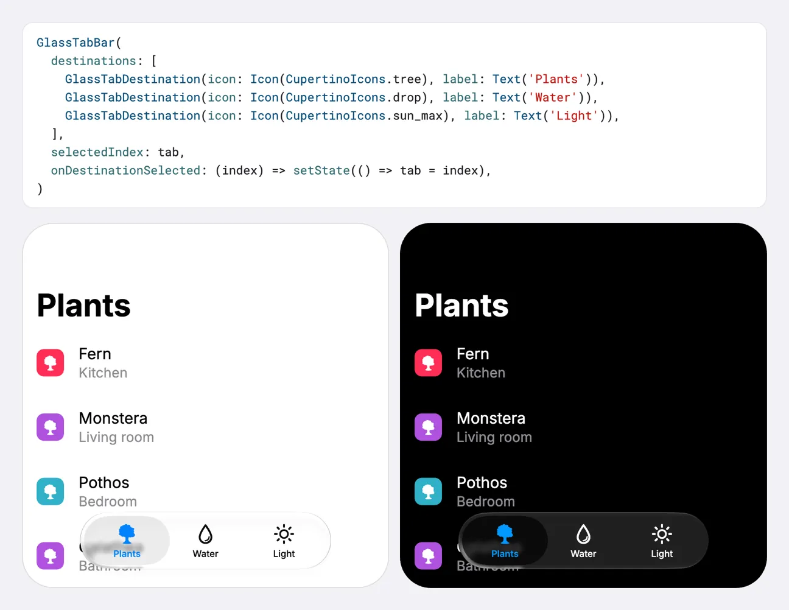

## Status

Pre-release (`1.0.0-dev`). The API may still change between versions.

## Requirements

- Flutter 3.47 or newer and Dart 3.13 or newer.
- Liquid glass needs Impeller and Flutter GPU. Without Flutter GPU, full
  glass does not load and the glass draws as fake glass. Turn Flutter GPU on
  in the app. The example app does it on all three platforms:
  - iOS, in `ios/Runner/Info.plist`:

    ```xml
    <key>FLTEnableFlutterGPU</key>
    <true/>
    ```

  - macOS, in `macos/Runner/Info.plist`: the same key.
  - Android, in `android/app/src/main/AndroidManifest.xml`, inside
    `<application>`:

    ```xml
    <meta-data
        android:name="io.flutter.embedding.android.EnableFlutterGPU"
        android:value="true" />
    ```

  The example also sets `FLTEnableImpeller` (iOS, macOS) and
  `io.flutter.embedding.android.EnableImpeller` (Android) to `true`. To try
  an app without editing these files, pass `--enable-flutter-gpu` to
  `flutter run`.
- Platforms: iOS, Android and macOS draw liquid glass. The web draws fake
  glass, because it has no shader filters. Windows and Linux are untested.

## Install

```sh
flutter pub add apple_liquid_glass
```

## Quick start

Put a `GlassScope` at the root, then build pages from the scaffolds. This
app has two tabs, a navigation bar with a button that shows an alert, a
switch, a slider and a pushed page. The icons come from
[`cupertino_icons`](https://pub.dev/packages/cupertino_icons).

```dart
import 'package:apple_liquid_glass/apple_liquid_glass.dart';
import 'package:flutter/cupertino.dart' show CupertinoIcons;
import 'package:flutter/widgets.dart';

Future<void> main() async {
  WidgetsFlutterBinding.ensureInitialized();
  await precacheGlass();
  runApp(const App());
}

class App extends StatelessWidget {
  const App({super.key});

  @override
  Widget build(BuildContext context) => WidgetsApp(
    color: const Color(0xFF007AFF),
    pageRouteBuilder: <T>(settings, builder) =>
        GlassPageRoute<T>(builder: builder, settings: settings),
    builder: (context, child) => GlassScope(child: child!),
    home: const Home(),
  );
}

class Home extends StatefulWidget {
  const Home({super.key});

  @override
  State<Home> createState() => _HomeState();
}

class _HomeState extends State<Home> {
  var _tab = 0;

  @override
  Widget build(BuildContext context) => GlassTabScaffold(
    tabBar: GlassTabBar(
      destinations: const [
        GlassTabDestination(
          icon: Icon(CupertinoIcons.house),
          label: Text('Home'),
        ),
        GlassTabDestination(
          icon: Icon(CupertinoIcons.gear),
          label: Text('Settings'),
        ),
      ],
      selectedIndex: _tab,
      onDestinationSelected: (index) => setState(() => _tab = index),
    ),
    tabBuilder: (context, index) =>
        index == 0 ? const HomePage() : const SettingsPage(),
  );
}

class HomePage extends StatelessWidget {
  const HomePage({super.key});

  Future<void> _ask(BuildContext context) async {
    final action = await showGlassAlert(
      context,
      title: const Text('Add a note?'),
      actions: [
        const GlassAlertAction.cancel(child: Text('Cancel')),
        GlassAlertAction(
          isDefaultAction: true,
          child: const Text('Add'),
          onPressed: () {},
        ),
      ],
    );
    debugPrint('Chosen: $action');
  }

  @override
  Widget build(BuildContext context) => GlassPageScaffold(
    navigationBar: GlassNavigationBar(
      largeTitle: const Text('Home'),
      trailing: [
        GlassBarItem(
          icon: const Icon(CupertinoIcons.add),
          semanticLabel: 'Add',
          onPressed: () => _ask(context),
        ),
      ],
    ),
    child: GlassContentScroll(
      child: ListView.builder(
        itemCount: 40,
        itemBuilder: (context, index) => Padding(
          padding: const EdgeInsets.all(16),
          child: Text('Row $index'),
        ),
      ),
    ),
  );
}

class SettingsPage extends StatefulWidget {
  const SettingsPage({super.key});

  @override
  State<SettingsPage> createState() => _SettingsPageState();
}

class _SettingsPageState extends State<SettingsPage> {
  var _wifi = true;
  var _volume = 0.5;

  @override
  Widget build(BuildContext context) => GlassPageScaffold(
    backgroundColor: GlassColors.systemGroupedBackground,
    navigationBar: const GlassNavigationBar(largeTitle: Text('Settings')),
    child: GlassContentScroll(
      child: ListView(
        children: [
          GlassListSection(
            children: [
              GlassListRow(
                title: const Text('Wi-Fi'),
                trailing: GlassSwitch(
                  value: _wifi,
                  onChanged: (on) => setState(() => _wifi = on),
                ),
              ),
              GlassListRow(
                child: GlassSlider(
                  value: _volume,
                  onChanged: (value) => setState(() => _volume = value),
                ),
              ),
            ],
          ),
          Padding(
            padding: const EdgeInsets.all(16),
            child: GlassButton.prominent(
              onPressed: () => Navigator.of(context).push(
                GlassPageRoute<void>(builder: (context) => const AboutPage()),
              ),
              child: const Text('About'),
            ),
          ),
        ],
      ),
    ),
  );
}

class AboutPage extends StatelessWidget {
  const AboutPage({super.key});

  @override
  Widget build(BuildContext context) => const GlassPageScaffold(
    navigationBar: GlassNavigationBar(title: Text('About')),
    child: Center(child: Text('Made with apple_liquid_glass')),
  );
}
```

`GlassScope` sits in `WidgetsApp.builder`, above the navigator, so pushed
pages and presentations get the same theme and renderer.
`GlassContentScroll` marks the scroll view the bars follow and draws the edge
effect where the content passes under a bar.

## Renderers

A renderer decides how every glass surface is drawn. A control never asks
which renderer draws it, and keeps its state when the renderer changes, even
mid-press.

| Renderer | Draws |
| --- | --- |
| `LiquidGlassRenderer` | Liquid glass. The members of a group share one glass layer. On a device without shader filters it draws fake glass. |
| `FakeGlassRenderer` | Glass blurred and lit, with no refraction and no touch glow. Cheaper than real glass, and the glass the web can draw. |
| `FlatGlassRenderer` | A fill per role, a hairline rim and a soft shadow under floating parts. No backdrop reads, no shader. |
| `AdaptiveGlassRenderer` | `capable` (liquid glass by default) where full glass runs well, `fallback` (fake glass by default) elsewhere, on the web, and while the system prefers that apps reduce their resource usage. |

- `GlassScope` uses `AdaptiveGlassRenderer` by default. Pass `renderer:` to
  pick another one.
- `GlassRendererScope` sets the renderer for a subtree.
- Without a `GlassScope` or a `GlassRendererScope` above, controls draw flat.
- `precacheGlass()` loads the shaders and finds what the device draws before
  the first glass frame, so the adaptive renderer draws its pick from that
  frame on. An app can await it before `runApp`. With `warmUp: true` it also
  draws every glass pipeline once offscreen. That costs one offscreen frame
  on every launch, and it spares a mid-range Android phone a stall on the
  first glass frame after an install.

```dart
GlassScope(
  renderer: const AdaptiveGlassRenderer(fallback: FlatGlassRenderer()),
  child: app,
)
```

```dart
GlassRendererScope(renderer: const FakeGlassRenderer(), child: panel)
```

An app's own renderer extends `GlassRenderer`, using public API only.

## Widgets in motion

Each animation shows a widget's code and a finger using it, in light and
dark, drawn by `LiquidGlassRenderer`. They're recorded in a widget test with
Impeller, so they show the same frames a device draws. To record them again
after a change, run `dart run tool/readme/render.dart`; it needs `img2webp`
from libwebp.

### Controls

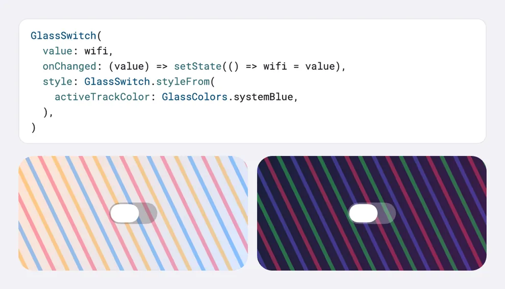
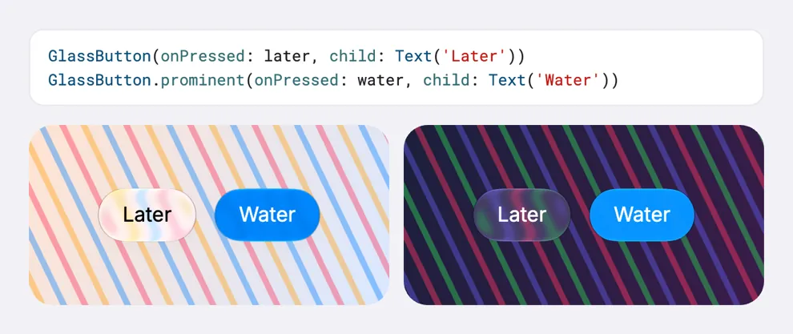
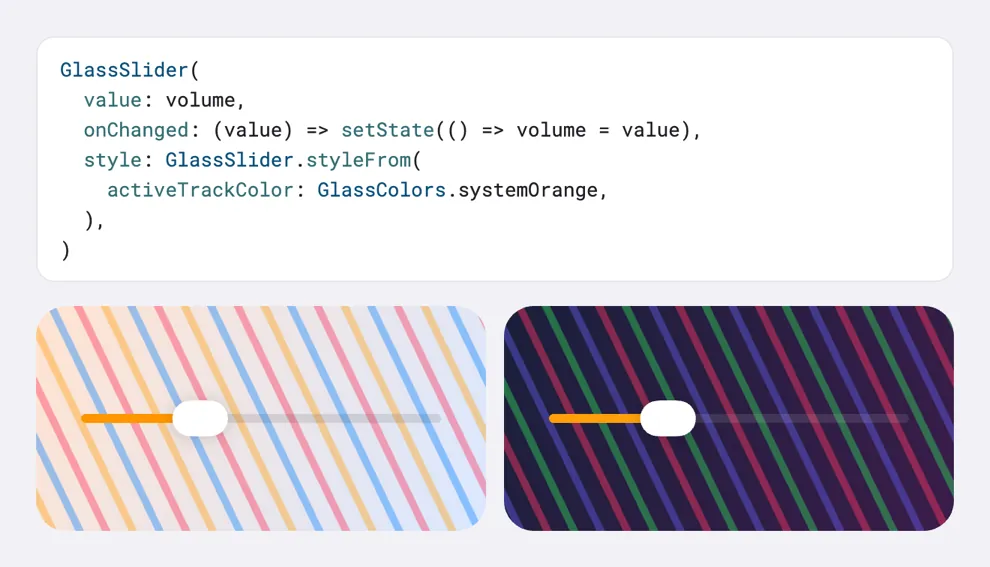
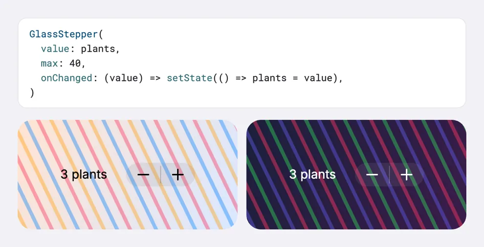
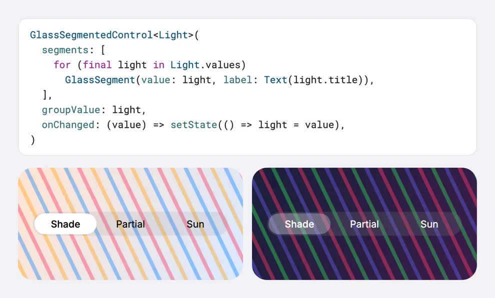
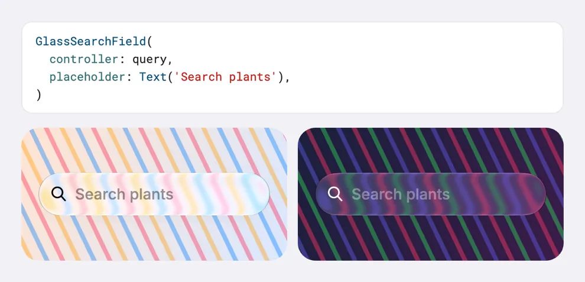
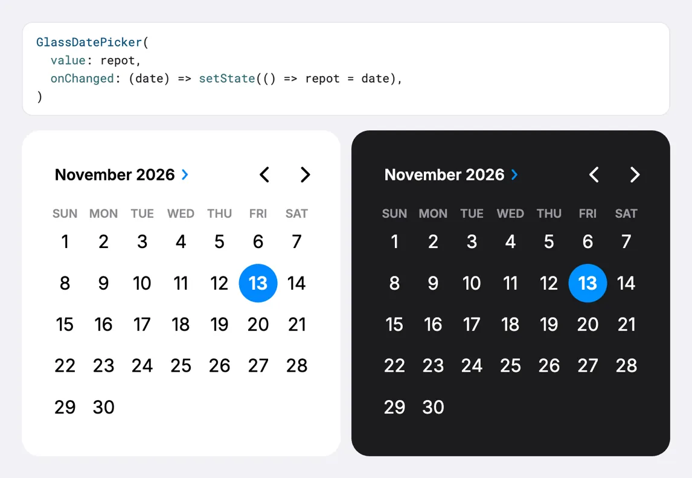

### Lists and bars

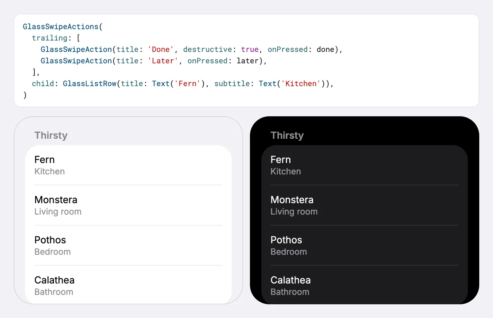
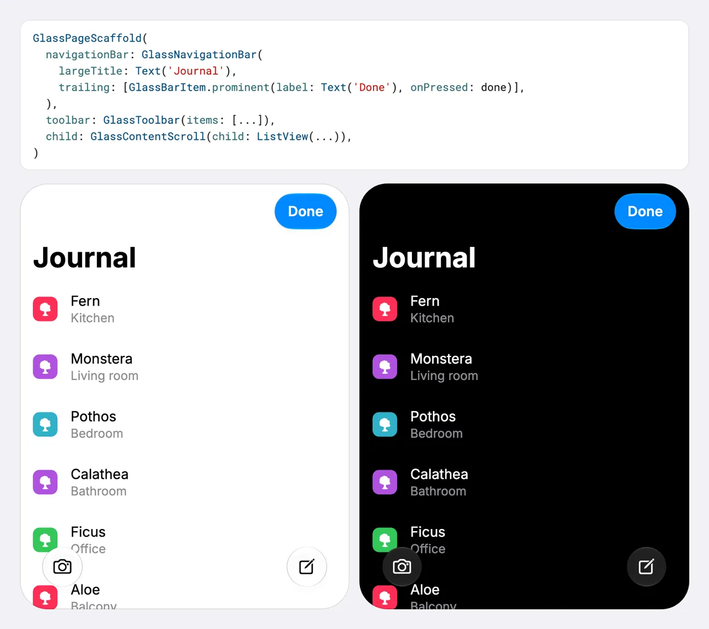

### Presentations

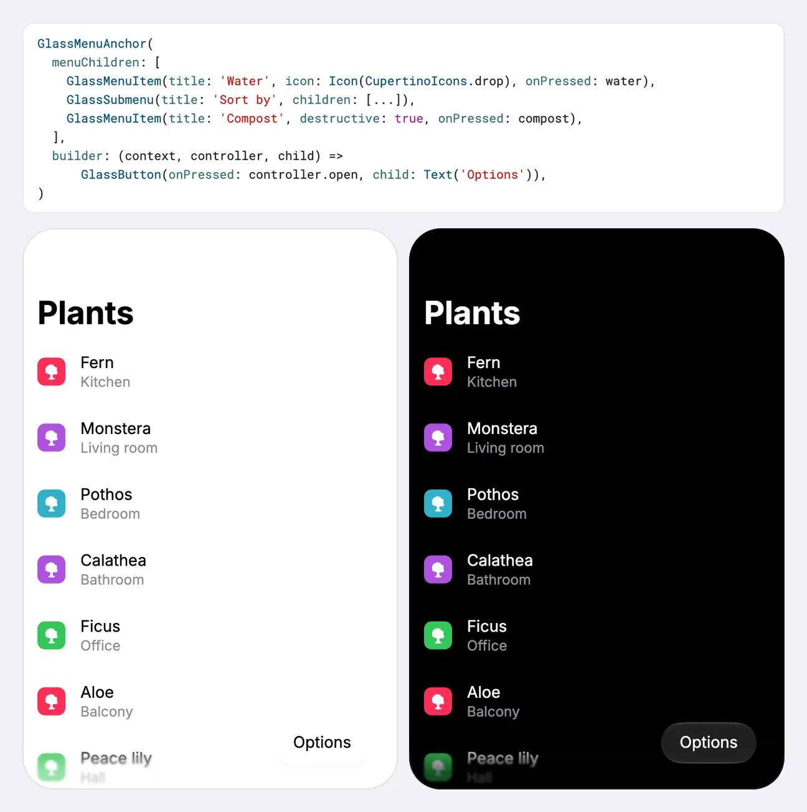
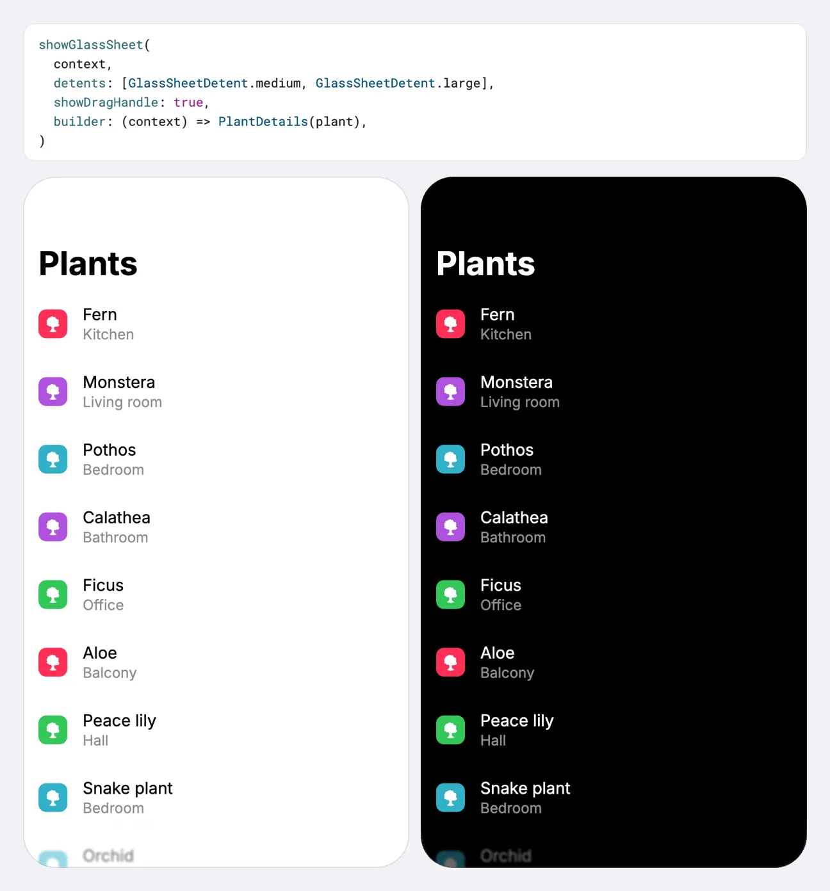
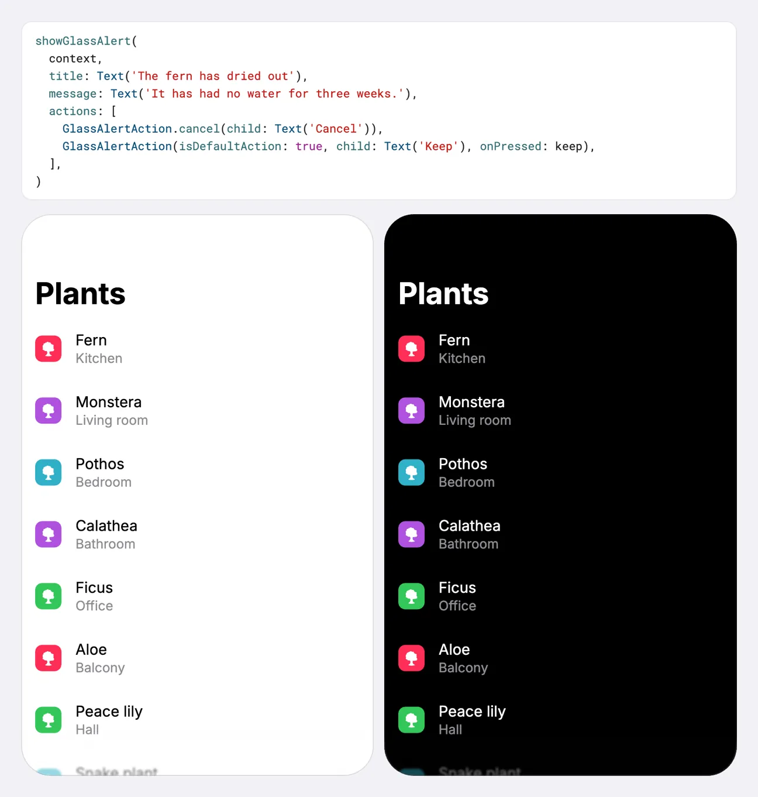

## What is in the package

`package:apple_liquid_glass/apple_liquid_glass.dart` exports every library
of the package, kinesis, and the glass renderer's shapes (`LiquidShape` and
its kinds) and fields (`LiquidGlassField`). `widgets.dart` holds the controls, navigation and
presentations below, and `surfaces.dart` the surfaces. The others are
`foundation.dart` (colors, type, theme, traits), `liquid.dart` (`GlassScope`,
the glass renderers and `precacheGlass`), `raw.dart` and `motions.dart`. Each
library can also be imported alone.

### Controls

| Name | What it is |
| --- | --- |
| `GlassButton` | A glass button: `GlassButton`, `.clear`, `.prominent`, `.prominentClear`. |
| `GlassSwitch` | A switch. |
| `GlassSlider` | A slider, optionally with ticks. |
| `GlassStepper` | A stepper with a minus and a plus half. |
| `GlassSegmentedControl` | A segmented control of `GlassSegment`s. |
| `GlassPageControl` | A page control that looks and steps like `UIPageControl`. |
| `GlassSearchField` | A search field. |
| `GlassSearchIcon`, `GlassCloseIcon` | The search magnifier and the close cross. |
| `GlassListSection` | One section of an inset grouped list: header, rows on a rounded card, footer. |
| `GlassSliverListSection` | A list section as a sliver that builds its rows lazily. |
| `GlassListRow` | A row of an inset grouped list: title, subtitle, detail, leading, trailing, accessory. |
| `GlassListBackground` | The page behind an inset grouped list. |
| `GlassSwipeActions` | A row that a finger swipes to show trailing `GlassSwipeAction`s. |
| `GlassDatePicker` | A month calendar date picker, in place. |
| `GlassTimePicker` | Hour and minute wheels, with an AM/PM wheel in 12-hour time. |
| `GlassBadge` | A badge on a tab: a count, a short text or a dot. |

### Navigation

| Name | What it is |
| --- | --- |
| `GlassPageScaffold` | A page whose content scrolls under a navigation bar and a toolbar. |
| `GlassNavigationBar` | A navigation bar: leading and trailing items, a title or large title, an optional search field. |
| `GlassToolbar` | Glass capsules floating over the bottom of the screen. |
| `GlassTabScaffold` | A tab bar floating over the bottom of the screen and the selected tab's page under it. |
| `GlassTabBar` | A tab bar of `GlassTabDestination`s, with an optional search tab and bottom accessory. |
| `GlassBarItem` | An item of a bar: a button (`GlassBarButton`), a prominent button (`GlassBarProminentButton`) or custom content (`GlassBarCustomItem`). |
| `GlassBarSpacer` | A break between capsules in a bar. |
| `GlassContentScroll` | Marks the scroll view the bars follow and draws its edge effects. |
| `GlassPageRoute` | A pushed page that slides in over the page below, or grows out of a `GlassZoomSource`. |

### Presentations

| Name | What it is |
| --- | --- |
| `GlassMenuAnchor` | Wraps a control, such as a `GlassButton`, whose glass grows into a menu. |
| `GlassContextMenu` | Shows a menu beside a lifted preview of its child when it is held. |
| `GlassMenuController` | Opens and closes a menu from code. |
| `GlassMenuItem`, `GlassSubmenu`, `GlassMenuSection`, `GlassMenuDivider`, `GlassMenuDeferred`, `GlassMenuWidget` | The entries of a menu. |
| `showGlassAlert` | Shows an alert and completes with the `GlassAlertAction` chosen. |
| `showGlassActionSheet` | Shows an action sheet and completes with the action chosen. |
| `showGlassSheet` | Shows a sheet over the page, with detents. |
| `showGlassPopover` | Shows content in a popover next to its source. |
| `GlassCompactDatePicker` | A label that opens its picker in an overlay. |

### Surfaces (`surfaces.dart`)

| Name | What it is |
| --- | --- |
| `GlassSurface` | A glass body behind its child, drawn by the ambient renderer. `GlassSurface.live` follows a moving frame without rebuilding. |
| `GlassGroup` | Surfaces that belong together, such as the buttons of a toolbar. `GlassMerge` says how they fuse. |
| `GlassClip` | Clips its child to a glass body. |
| `GlassSolidBackdrop` | Says which color lies under the glass, so the glass reads nothing of the screen. |
| `GlassRendererScope` | Sets the renderer below it. |
| `GlassRenderer` | The base class of every renderer. |
| `FlatGlassRenderer` | The flat renderer. |

A glass card of your own follows the renderer the app picks:

```dart
const GlassSurface(
  shape: LiquidRoundedSuperellipse(radius: 24),
  role: GlassRole.panel,
  child: Padding(padding: EdgeInsets.all(20), child: Text('A glass card')),
)
```

## Theming

`GlassScope(data: GlassThemeData(...))` themes everything below it, and a
`GlassTheme` themes a subtree. A nested theme merges into the enclosing one.
When `data` changes, `GlassScope` moves to the new theme on a spring, or at
once under Reduce Motion.

- `GlassThemeData` holds `brightness` (null follows the platform),
  `primaryColor` (the accent), `fontFamily`, a `GlassColorScheme` (the label
  colors and the flat fill per role) and `styles`.
- Every control has a `*Style` (`GlassButtonStyle`, `GlassSwitchStyle`,
  `GlassSliderStyle`, and so on) shaped like Flutter's `ButtonStyle`, and a
  static `styleFrom` that builds one from plain values. A control reads a
  field from its own `style`, then from the theme's style of that type, then
  from its defaults. Prominent buttons read a `GlassProminentButtonStyle`
  from the theme.
- `GlassDynamicColor` resolves against brightness, contrast and interface
  level. `GlassColors` holds the iOS palette (`label`, `systemBlue`,
  `systemGroupedBackground`, and more). `GlassDynamicColor.resolve(color,
  context)` gives the color for the traits at `context`.

```dart
const brand = GlassDynamicColor.withBrightness(
  color: Color(0xFF34C759),
  darkColor: Color(0xFF30D158),
);

Widget themed(Widget app) => GlassScope(
  data: GlassThemeData(
    primaryColor: brand,
    styles: [
      GlassSwitch.styleFrom(activeTrackColor: brand),
      GlassButton.styleFrom(foregroundColor: const Color(0xFFFF9500)),
    ],
  ),
  child: app,
);
```

```dart
GlassButton(
  onPressed: save,
  style: GlassButton.styleFrom(padding: const EdgeInsets.all(20)),
  child: const Text('Save'),
)
```

## Motion

The widgets move on
[kinesis](https://github.com/whynotmake-it/flutter_liquid_glass/tree/main/packages/kinesis),
which this package exports: springs (`Spring`), values that keep their
velocity when retargeted (`MotionValue`, `withSpring`), gestures as pure
logic, and the presentation engine under the menus, alerts and sheets. A
motion that is interrupted continues from where it is, at the speed it has.

- `raw.dart` holds the behavior cores without a look (`RawGlassButton`,
  `RawGlassSwitch`, `RawGlassSlider`, `RawGlassStepper`, `RawGlassSelector`,
  and more). A core runs its control's motion and takes its input, focus,
  keys and semantics, and your builder draws it. Use one for a control with a
  look of your own.
- `motions.dart` holds the laws themselves (`SwitchMotion`, `SliderMotion`,
  `SheetMotion`, `MenuMotion`, and more) as pure classes on kinesis's
  `Motion`.

## Accessibility

What the widgets do today:

- Semantics: controls take a `semanticLabel`. The stepper also takes
  `incrementLabel`, `decrementLabel` and `semanticFormatterCallback`. The
  words the widgets say to assistive technology come from
  `GlassLocalizations`: English (`DefaultGlassLocalizations`) unless the app
  registers a `LocalizationsDelegate<GlassLocalizations>`.
- Keyboard and focus: controls take a `focusNode` and `autofocus`. A button
  is pressed by the app's `ActivateIntent` (Space and Enter under a
  `WidgetsApp`) and by the accessibility tap. A control focused from the
  keyboard draws Flutter's Cupertino focus ring, and one under a mouse a
  hover response. A presentation moves focus in when it opens, keeps Tab
  inside while it is modal, closes on Escape and Back, and returns focus to
  the control that opened it.
- Touch targets: a button takes a finger within a 44 by 44 point area around
  a smaller body, where its parent leaves that room.
- Text scale: text follows the app's text scale. Some fixed-size parts cap
  it at a documented `maxTextScale` (`GlassTabBar`, `GlassDatePicker`,
  `RawGlassSearchField`).
- Contrast and bold text come from `MediaQuery` into `GlassTraits`.
  `GlassDynamicColor` has high-contrast variants.
- Reduce Motion is read from the platform (Reduce Motion or disabled
  animations) or from kinesis's `MotionTraitsOverride`. A widget that moves
  differently under it says so in its dartdoc.
- Reduce Transparency: Flutter does not report it. The
  [`apple_liquid_glass_accessibility`](../apple_liquid_glass_accessibility)
  package reads it on iOS and macOS, along with Show Borders, Prefer
  Cross-Fade Transitions and, from iOS 27, whether the system prefers that
  apps reduce their resource usage. Without that package, pass it in with
  `GlassTraitsOverride(reduceTransparency: true, child: ...)`. The liquid and
  fake renderers then draw the surfaces flat.

## Fidelity

Motion and metrics are measured on iOS 27 (iPhone 16 Pro) and replayed in
the package's tests. Where a widget departs from UIKit, or a value is not
measured, its dartdoc says so.

## Performance

Liquid glass costs GPU time on every frame it is on screen. Fake glass is
cheaper, and flat glass reads no backdrop and runs no shader. An app can let
its users choose by switching the renderer of its `GlassScope` at run time.
The controls keep their state across the switch. `AdaptiveGlassRenderer`
switches to its fallback on its own while
`GlassTraits.prefersReducedResourceUsage` is on, which
`apple_liquid_glass_accessibility` reports from iOS 27.

## Example

The gallery in [`example`](example) shows every control, menu and
presentation, with the renderer switchable live:

```sh
cd packages/apple_liquid_glass/example
flutter run --release
```

## License

Apache 2.0, see [LICENSE](LICENSE).
