# Liquid Glass Renderer

[](https://pub.dev/packages/liquid_glass_renderer)
[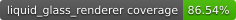](./test/)
[![lints by lintervention][lintervention_badge]][lintervention_link]

iOS 27-style Liquid Glass for Flutter: refraction through a rounded bevel,
frost, tint, a directional glint, a dark border, and shapes that melt into each
other. It is fitted against captures of Apple's own glass, and it ships presets
for the regular, toolbar and clear materials, including the Settings Liquid
Glass slider.

It reproduces the look with Flutter's own rendering; it does not use Apple's
private material APIs.

| Light | Dark |
| --- | --- |
| 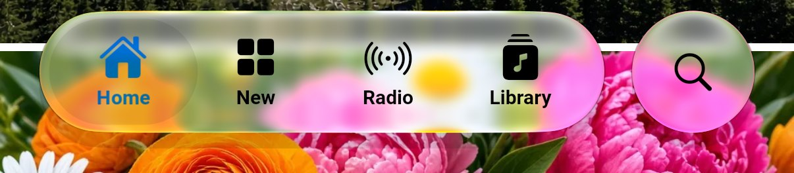 | 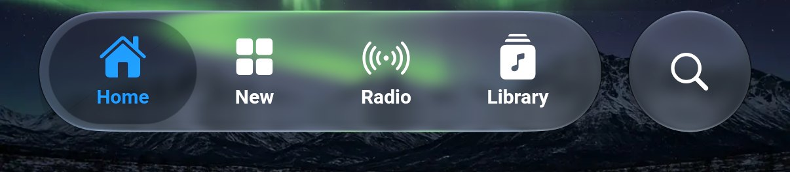 |
| 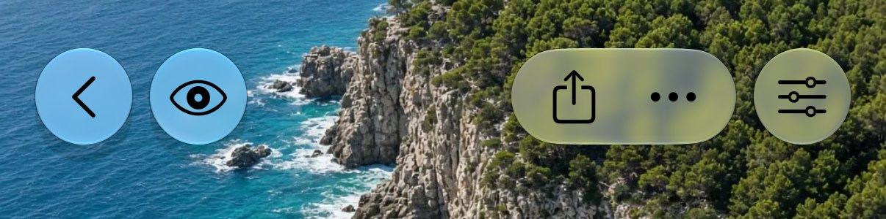 | 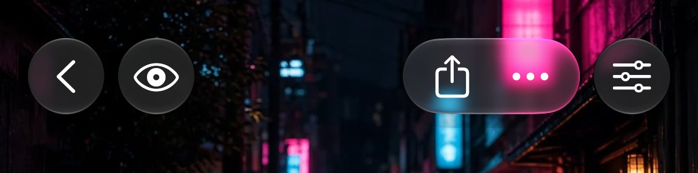 |

> **1.0 prerelease: the renderer was rewritten.**
>
> `1.0.0-dev` replaces the whole API of `0.2.x`. There are no deprecations;
> see the [changelog](CHANGELOG.md) for what moved where. Full glass needs
> Impeller and the Flutter GPU API, which is still in preview. APIs and
> rendering may change before 1.0. Profile your real screens on physical
> devices before shipping.

## Contents

- [Requirements](#requirements)
- [Quick start](#quick-start)
- [The widgets](#the-widgets)
- [Blending shapes](#blending-shapes)
- [Custom outlines](#custom-outlines)
- [iOS 27 presets and the Liquid Glass slider](#ios-27-presets-and-the-liquid-glass-slider)
- [Tint and color](#tint-and-color)
- [Refraction](#refraction)
- [Glint](#glint)
- [Visibility](#visibility)
- [FakeGlass](#fakeglass)
- [Glass on glass](#glass-on-glass)
- [Performance](#performance)
- [Example playground](#example-playground)

## Requirements

- Flutter 3.47 or newer.
- Impeller and Flutter GPU for full glass. Pass `--enable-flutter-gpu` to
  `flutter run`, or turn it on in the app: `FLTEnableFlutterGPU` in
  `Info.plist` (iOS, macOS) and the
  `io.flutter.embedding.android.EnableFlutterGPU` meta-data in
  `AndroidManifest.xml`. The example app shows both.
- iOS, Android and macOS are the platforms the renderer is tested on. Web
  builds compile and render [FakeGlass](#fakeglass). Windows and Linux are
  untested.

Wherever full glass is unavailable, layers switch to `FakeGlass`
automatically.

```sh
flutter pub add liquid_glass_renderer
```

## Quick start

Glass samples the pixels behind it, so put your content and the glass in a
`Stack`:

```dart
import 'package:flutter/widgets.dart';
import 'package:liquid_glass_renderer/liquid_glass_renderer.dart';

class GlassPill extends StatelessWidget {
  const GlassPill({super.key});

  @override
  Widget build(BuildContext context) {
    final brightness = MediaQuery.platformBrightnessOf(context);
    return Stack(
      children: [
        const Positioned.fill(child: MyContent()),
        Center(
          child: LiquidGlassLayer(
            settings: LiquidGlassSettings.ios27Regular(brightness: brightness),
            child: const LiquidGlass(
              shape: LiquidRoundedSuperellipse(borderRadius: 28),
              child: SizedBox(width: 220, height: 56),
            ),
          ),
        ),
      ],
    );
  }
}
```

Shaders and the GPU pipeline load on first use, so the first glass on screen
paints `FakeGlass` for a frame or two. Optionally load them before `runApp`:

```dart
Future<void> main() async {
  WidgetsFlutterBinding.ensureInitialized();
  await LiquidGlass.precache();
  runApp(const MyApp());
}
```

Awaiting precache trades startup time for having glass resources ready when
the UI mounts.
It does not eliminate all first-use GPU work; omit it if showing an initial
fallback is preferable to delaying startup.

The first glass frame also creates the GPU pipelines that glass draws with. On
a mid-range Android phone, that stalls the frame the first time an installed
app shows glass. Later launches load the pipelines from the disk cache.
`LiquidGlass.precache(warmUp: true)` creates them offscreen during the
precache instead, at the cost of one offscreen frame on every launch.

### Is full glass available?

Layers fall back to `FakeGlass` by themselves. To know before you build them,
for example to pick an opaque look on a weak GPU, read the
`LiquidGlassSupport` that `LiquidGlass.precache()` returns:

```dart
Future<void> main() async {
  WidgetsFlutterBinding.ensureInitialized();
  final support = await LiquidGlass.precache();
  if (!support.available) {
    debugPrint('Fake glass: ${support.unavailableReason}');
  }
  runApp(MyApp(fullGlass: support.available));
}
```

- `available`: every full-glass program and the Flutter GPU geometry bundle
  loaded, so layers can draw full glass.
- `unavailableReason`: why full glass is unavailable, when it is.
- `deviceClass`: the kind of GPU, a `LiquidGlassDeviceClass`: `capable`
  (Vulkan, Metal on a Mac or an Apple GPU from the A13, or OpenGL ES on a
  desktop), `gles` (Impeller's OpenGL ES fallback on an Android device
  without a usable Vulkan driver, where full glass costs more frame time),
  `appleBeforeA13`, `noShaderFilters` (Skia or the web) or `unknown` (full
  glass did not load, for example because Flutter GPU is not enabled).

## The widgets

| Widget | What it does |
| --- | --- |
| `LiquidGlassLayer` | Draws every glass shape below it together. Owns the shared `LiquidGlassSettings`. |
| `LiquidGlass` | One glass shape. Its child paints on top of the glass, clipped to the shape. |
| `LiquidGlassBlendGroup` | Melts the `LiquidGlass.grouped` shapes inside it into one surface. |
| `LiquidGlassVisibility` | Fades the glass in a subtree in and out. |
| `FakeGlass` | The fallback without refraction, used automatically where full glass is unavailable. |
| `LiquidGlassSettings` | Refraction, frost, glint, border and inner shadow, shared by a layer. |
| `LiquidGlassAppearance` | Tint, color model and visibility, per shape or as a layer default. |

`LiquidGlass` has five constructors:

| Constructor | Use it when |
| --- | --- |
| `LiquidGlass(...)` | A `LiquidGlassLayer` is above it. |
| `LiquidGlass.grouped(...)` | It sits in a `LiquidGlassBlendGroup` and should blend with its neighbors. |
| `LiquidGlass.auto(...)` | Reusable code that may or may not have a layer above it. It uses a parent layer when there is one and creates its own otherwise. |
| `LiquidGlass.withOwnLayer(...)` | It needs its own backdrop sample or its own settings, for example glass on glass. |
| `LiquidGlass.live(frame: ...)` | Its geometry, appearance and shadows follow a `ValueListenable<LiquidGlassShapeFrame>`, for glass that moves every frame. Each new frame goes straight into the render objects without a rebuild. Hit testing follows the box the widget was laid out in. `grouped: true` joins the nearest `LiquidGlassBlendGroup`. |

Put sibling shapes in one layer. A layer draws all its shapes together and
pays its per-layer work once. [Performance](#performance) says what glass
costs.

Shapes are `LiquidRoundedSuperellipse` (squircles and capsules), `LiquidOval`
and `LiquidRoundedRectangle`. A rounded rectangle has one corner radius. A
superellipse has one radius, or a separate radius for its two bottom corners
with `bottomRadius`. Exterior shadows go on the shape, and the renderer cuts
them out behind the translucent glass:

```dart
LiquidGlass(
  shape: const LiquidRoundedSuperellipse(borderRadius: 28),
  shadows: const [
    BoxShadow(color: Color(0x24000000), offset: Offset(0, 6), blurRadius: 20),
  ],
  child: const SizedBox(width: 220, height: 56),
)
```

`GlassGlow` adds a touch glow inside the glass, and `LiquidStretch` gives it
the squash and stretch of iOS controls while it is dragged. Both come from
`package:liquid_glass_renderer/effects.dart`.

The main import holds what every app needs: the values in `painting.dart` and
the widgets in `widgets.dart`. Import the other libraries by name:

- `effects.dart` for `GlassGlow` and `LiquidStretch`
- `rendering.dart` for the render objects and layers
- `composer.dart` for the frame plan and its report

## Blending shapes

| Light | Dark |
| --- | --- |
| 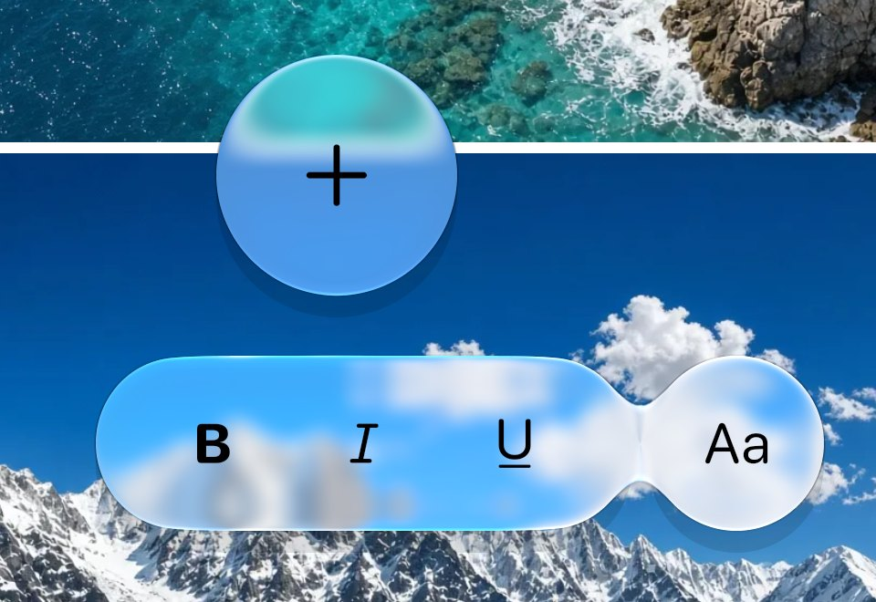 | 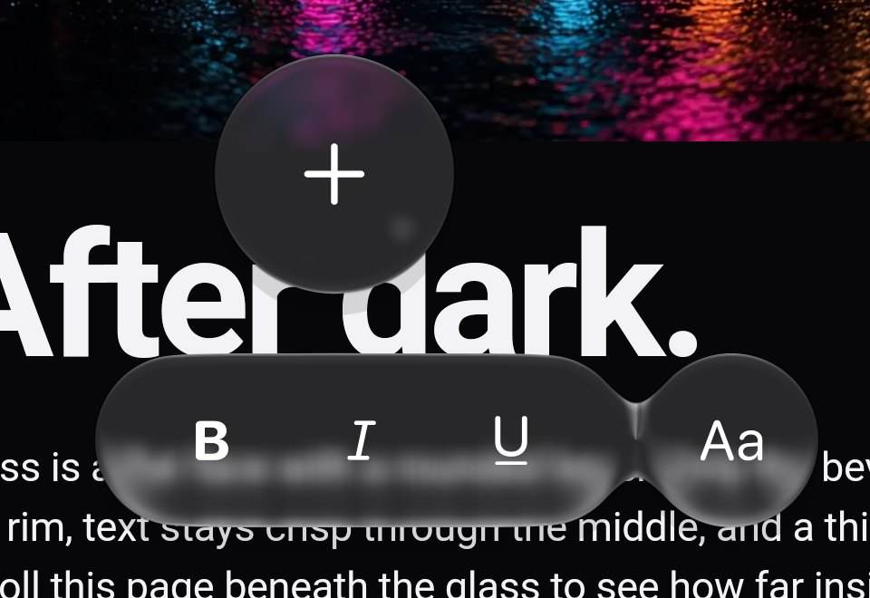 |

Shapes in a `LiquidGlassBlendGroup` join like drops of water once they come
within `blend` logical pixels of each other (default `20`). Straight edges that
touch stay straight; only the gap between them rounds, as in iOS 27's
`GlassEffectContainer`.

```dart
LiquidGlassLayer(
  child: LiquidGlassBlendGroup(
    blend: 24,
    child: Row(
      children: const [
        LiquidGlass.grouped(
          shape: LiquidOval(),
          child: SizedBox.square(dimension: 56),
        ),
        SizedBox(width: 8),
        LiquidGlass.grouped(
          shape: LiquidRoundedSuperellipse(borderRadius: 28),
          child: SizedBox(width: 180, height: 56),
        ),
      ],
    ),
  ),
)
```

A layer renders any number of shapes, as long as no more than 16 of them blend
or sit within a few pixels of each other. A layer whose shapes have their own
appearances, or a layer with a field, holds at most 16 shapes. Plain
`LiquidGlass` shapes in the same layer don't blend.

## Custom outlines

A layer can shade a body of any outline in place of its shapes' own: give it
the body's signed distance field. `LiquidGlassField.fromPath` computes one
from any closed `Path`, in the layer's coordinates:

```dart
final star = Path()..addPolygon(points, true);

LiquidGlassLayer(
  field: LiquidGlassField.fromPath(star),
  child: Stack(
    children: [
      Positioned.fromRect(
        rect: star.getBounds(),
        child: const LiquidGlass(
          shape: LiquidRoundedRectangle(borderRadius: 0),
          child: SizedBox.expand(),
        ),
      ),
    ],
  ),
)
```

The shape under the field still supplies the appearance, the shadow, the
content clip and the bounds of the glass, which must contain the body. A layer
shades one field, so every custom body takes a layer of its own. Building a
field measures every node against the whole edge (about 90 ms in a debug build
for 300 x 200 at the default step of 2): compute it when the path changes and
keep it, not once a frame. A widget that knows its outline analytically can
fill a `LiquidGlassField` itself instead.

## iOS 27 presets and the Liquid Glass slider

Glass is configured in two parts. `LiquidGlassSettings` on the layer holds the
optics and lighting. `LiquidGlassAppearance` holds the color, either as the
layer's `defaultAppearance` or per shape.

| Material | Settings | Appearance |
| --- | --- | --- |
| Regular (`.regular`: toolbars, tab bars, `.glass` buttons) | `ios27Regular(brightness:, tintAmount: t)` | `ios27Regular(brightness:)` |
| Clear (`.clear`) | `ios27Clear(tintAmount: t)` | `ios27Clear()` |

Light and dark variants exist as separate constructors too
(`ios27RegularLight`, `ios27RegularDark`). A layer without a
`defaultAppearance` uses the regular appearance for the platform brightness.

```dart
final brightness = MediaQuery.platformBrightnessOf(context);

LiquidGlassLayer(
  settings: LiquidGlassSettings.ios27Regular(brightness: brightness),
  defaultAppearance: LiquidGlassAppearance.ios27Regular(brightness: brightness),
  child: const MyToolbar(),
)
```

`t` is the slider position described below. The presets are fitted to
Apple's glass at toolbar and button size. They are a
starting point: Apple also varies its glass with the control's role, size and
accessibility settings.

### `tintAmount`: the Liquid Glass slider

iOS 27 has a Liquid Glass slider in Settings, from Clear (`0`) to Tinted
(`1`). Pass its position as `tintAmount`. The renderer does not read the
system setting; your app decides.

```dart
LiquidGlassSettings.ios27Regular(brightness: brightness, tintAmount: 0.5)
```

The slider changes three things, each along a curve fitted to Apple's glass:

- **Wash.** The iOS 27 color model makes its neutral wash more opaque, and
  dark glass denser.
- **Border.** The dark border gets stronger.
- **Blur.** The presets derive `frost` from the slider and scale the
  toolbar-size value by the glass's short side.
  `LiquidGlassSettings.ios27RegularFrost(tintAmount)` gives 4.5, 6.9 and
  18.7 pt at 0, 0.5 and 1 at toolbar size; `ios27ClearFrost(tintAmount)` gives
  0.35, 1.28 and 16.4 pt, growing at one rate up to the middle tick and at
  twice that rate beyond it. Pass `frost` to override.

The glint doesn't change. The direct color model ignores `tintAmount`, and
`tintAmount` never changes an explicit `frost`.

## Tint and color

| Light | Dark |
| --- | --- |
| 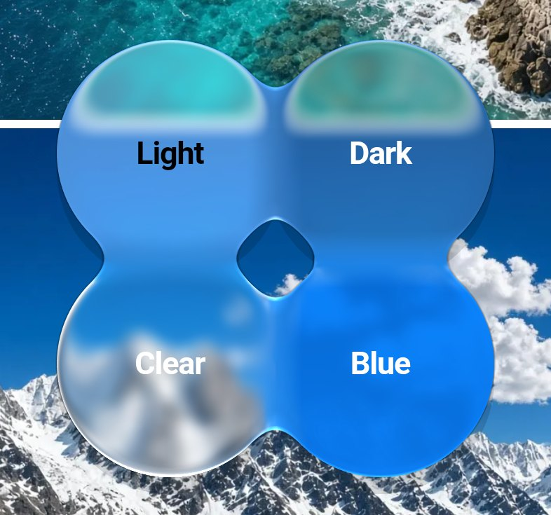 | 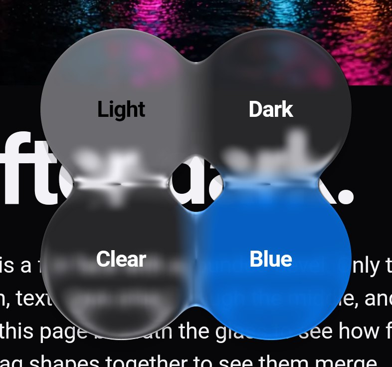 |

Tint a single shape through its appearance. Neighbors in a blend group
cross-fade their colors where they meet, from the same backdrop sample:

```dart
LiquidGlass.grouped(
  appearance: const LiquidGlassAppearance.ios27RegularLight(
    tint: Color(0xFF0A84FF),
  ),
  shape: const LiquidOval(),
  child: const SizedBox.square(dimension: 72),
)
```

The iOS 27 presets use `LiquidGlassColorModel.ios27`. It turns one tint color
and its opacity into tones that depend on the brightness of the backdrop,
like Apple's single-tint API. Clear glass (`LiquidGlassColorModel.ios27Clear`)
is the same in light and dark.

For full control, use the direct model and tune each transfer yourself:

```dart
const LiquidGlassAppearance(
  tint: Color(0x663B82F6),
  colorModel: LiquidGlassColorModel.direct(
    saturation: 1.4,
    transmissionGamma: 0.9,
    vibrancy: 0.15,
  ),
)
```

A layer where every shape has the same appearance keeps a smaller shader path.

## Refraction

Glass is modeled as a flat face with a rounded bevel along its edge. Only the
bevel refracts; the face shows the backdrop undisplaced.

- `refractionHeight`: the bevel width in logical pixels (iOS 27: `20`).
- `refractionAmount`: how far inside the silhouette the outermost pixel samples
  the backdrop (iOS 27: `60`). The displacement falls off across the bevel as
  a quarter circle. Above a ratio of 1 to `refractionHeight`, content near the
  rim is mirrored, as on Apple's glass. `0` turns refraction off.
- `refractionFitsShape` (default `true`): small shapes shrink the lens like
  iOS 27 regular glass. The bevel is at most a quarter of the short side, and
  the rim samples no deeper than the center line. Clear glass sets it to
  `false`.
- `backdropShrink`: shrinks the backdrop seen through the whole face. `0`
  keeps its size and `0.08` shows it at 92%. It never enlarges, so the glass
  never pixelates the backdrop. All glass in a layer shrinks about the center
  of the layer's glass; give a shape its own layer to shrink it about itself.
- `backdropShrinkRim` (`0` to `1`): where `backdropShrink` shrinks about. At
  `0`, that is the center of the layer's glass. At `1`, it is the long center
  line of the glass's bounds, so a capsule shows the backdrop in place along
  its length and shrinks it only across the capsule and around its ends.
- `backdropPull` and `backdropPullHeight`: the edge reads the backdrop up to
  `backdropPull` logical pixels outside the glass, falling to nothing
  `backdropPullHeight` from the edge. Glass deeper than that shows its middle
  in place and at its own size, where `backdropShrink` shows all of it smaller.
- `dispersion`: splits the colors in the refracted edge. Red moves by
  `1 + dispersion / 2` and blue by `1 - dispersion / 2` times the edge
  displacement; negative values bend blue more, as real glass does. iOS 27
  regular and clear glass show none, so it defaults to `0`, which is also the
  cheapest setting to render.
- `aberration` and `aberrationDepth`: parts the colors of everything the glass
  shows, not only of the bevel: red shows what lies up to `aberration` logical
  pixels toward the edge and blue what lies as far toward the middle, in full
  at the edge and fading to nothing `aberrationDepth` from it. Glass that
  parts colors draws with a larger shader variant, so leave it at `0` where it
  is not wanted.

`backdropPull` and `aberration` give a lifted iOS lens its look. Both default
to `0`.

The backdrop is always sampled bilinearly, so refracted lines move smoothly
instead of snapping to whole pixels.

### Magnifiers

`backdropShrink` never magnifies, because enlarging a captured backdrop makes
it blurry. The [example playground](#example-playground) shows how to build an
iOS 27 text loupe instead: it re-renders the content under the lens at the
magnified resolution and draws `LiquidGlass.withOwnLayer` on top, so text stays
sharp. The loupe is example code, not part of the package; copy
[`example/lib/loupe/liquid_glass_loupe.dart`](example/lib/loupe/liquid_glass_loupe.dart)
if you need one.

| Light | Dark |
| --- | --- |
| 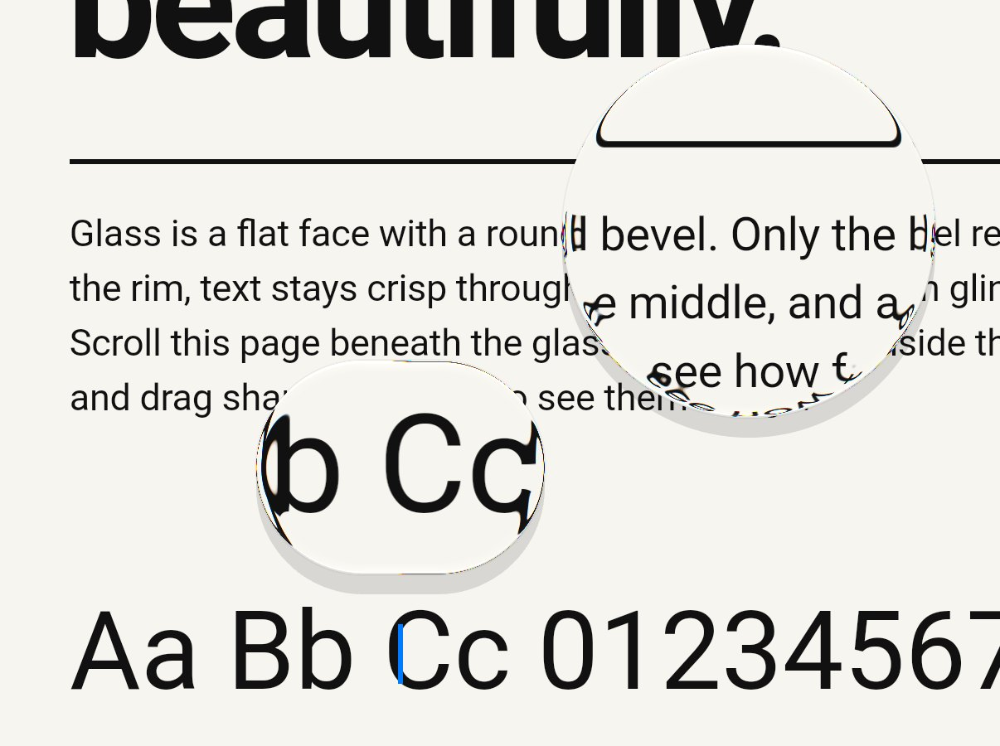 |  |

## Glint

The glint is the thin bright line along the rim, on the two walls facing
along the light. It recolors the glass instead of adding white: glass over color glints in that
color.

`highlight` sets its strength; `1` matches iOS 27 on an iPhone. The line is
1.2 pt wide, equally bright on both walls, and fades around corners as on
iOS 27.

Two more strengths shape the rim: `contourStrength` is the 0.75 pt dark border
just outside the silhouette (`contourDirectionality` concentrates it where the
glint fades), and `bevelShadowStrength` is the faint inner shadow the rim casts
on the face. The defaults and presets set all of them.

### HDR

The glint aims at a color brighter than SDR white. Full glass writes that value
unclamped, so whether it reaches the display depends on the surface Flutter
renders into:

- **iOS**: set `FLTEnableWideGamut` to `true` in `Info.plist`. The surface then
  holds values up to about 1.25, so the brightest part of the glint is
  compressed. Flutter's layer doesn't request extended dynamic range, so the
  values above 1.0 only reach the display once the app sets
  `wantsExtendedDynamicRangeContent` on the Flutter view's `CAMetalLayer`; the
  example app does this in its app delegate.
- **macOS**: with `FLTEnableWideGamut` on capable hardware, the surface keeps
  the full range.
- **Android**: 8-bit surfaces, so the glint is SDR.

`FakeGlass` writes the same glint headroom into an opaque surface. It reaches
above SDR white on the same extended-range surfaces; elsewhere it clamps to
white like the real renderer.

## Visibility

Visibility is per shape, not a layer setting. Set
`LiquidGlassAppearance.visibility` for one shape, or animate
`LiquidGlassVisibility` around a subtree:

```dart
LiquidGlassVisibility(
  visibility: animation.value,
  child: const Row(
    children: [
      LiquidGlass(shape: LiquidOval(), child: SizedBox.square(dimension: 56)),
      LiquidGlass(shape: LiquidOval(), child: SizedBox.square(dimension: 56)),
    ],
  ),
)
```

As visibility falls, the glass dissolves: refraction goes to zero, lighting and
blur fade, and the shape's child fades with it. Children stay mounted and
interactive. Nested scopes multiply (`0.5` inside `0.4` gives `0.2`). A layer
whose shapes are all invisible stops sampling the backdrop.

Don't fade glass with `Opacity` or `FadeTransition` between the layer and its
shapes; that only fades the children. `Opacity` above a whole
`LiquidGlassLayer` works.

## FakeGlass

| Full glass | `FakeGlass` |
| --- | --- |
|  | 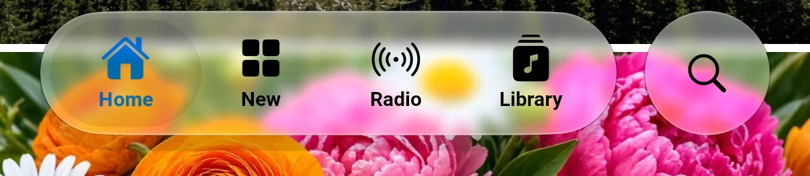 |
|  | 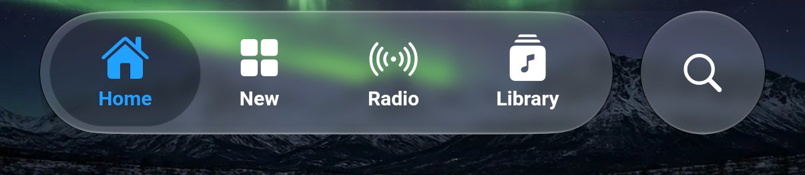 |

Full glass bends the backdrop at the rim; `FakeGlass` keeps everything else.

`FakeGlass` renders glass with a backdrop filter instead of the Flutter GPU
pipeline. Layers use it automatically where full glass is unavailable (Skia,
the web, no Flutter GPU). Set `fake: true` on a layer to use it on purpose, or
to test that path.

It keeps frost, tint, the color model, the glint, the border, the inner
shadow, visibility and exterior shadows. It leaves out refraction,
`backdropShrink`, `dispersion` and the direct model's vibrancy.

`FakeGlass` is not a cheaper mode: it pays for the same backdrop readback and
blur as full glass (see below).

## Glass on glass

Apple's guidance is not to stack glass on glass. Sometimes you have to, for
example with an indicator that slides over its tab bar and should refract it.

Where it can, glass doesn't read the screen live. Each layer paints over a
copy of what lies under it, drawn from the layer tree while the frame
composites and kept while that content stays the same. Glass that sits close
together shares one copy. Glass on glass works the same way: the copy under
the indicator holds the bar, so the indicator refracts it, and the frame draws
that copy after the bar's.

| | The top glass shows | Trade-off |
| --- | --- | --- |
| Shapes in one `LiquidGlassLayer` | The content below | Shared settings. The shapes can't refract each other. |
| Independent layers (default) | The glass below | One more copy for the glass on top. |

## Performance

The unit of cost is the backdrop read, not the glass widget. Glass paints
over a copy of what lies under it (see [Glass on glass](#glass-on-glass)), and
a frame whose glass all paints over copies skips Impeller's offscreen pass and
its screen readbacks. Glass reads the screen live only where no copy can be
drawn: over a texture, a platform view, or glass that itself reads live. On
top of that, a plain blur, `FakeGlass` and full glass each cost progressively
more, and every glass shadow adds its own cost.

Best practices:

- **Put siblings in one layer.** A layer draws all its shapes together and
  pays its own per-layer work once.
- **Keep layers small.** A layer's cost grows with the area its glass covers.
- **Don't animate blend-group geometry every frame.** Moving one shape in a
  group re-renders the whole group's geometry, which can drop frames. Static
  geometry is cached.
- **Keep shadows few and small.**
- **Mind the blur.** Larger blurs cost more, but Impeller picks a power-of-two
  downsample factor from the blur's device-space size and only starts
  downsampling above roughly 5.8 device pixels, so very small blurs can cost
  more than moderate ones. Preset and default `frost` is raised to that point
  per device and scaled by the glass's short side; an explicit `frost` is used
  as given.
- **For low power, don't sample the backdrop.** `FakeGlass` pays the same copy
  and blur as full glass. When the device or power state calls for it, draw an
  opaque surface instead.
- **Optionally await `LiquidGlass.precache()` before `runApp`.**

Measurements are in the
[performance audit](example/tool/results/performance-audit.md), and the
[Android GPU power harness](example/tool/README.md#android-pixel-10)
measures your own screens.

## Example playground

```sh
cd packages/liquid_glass_renderer/example
flutter run --enable-impeller --enable-flutter-gpu
```

The playground has an iOS-style tab bar and toolbar, blending and color
scenes, the text loupe, every preset in light and dark, the Liquid Glass
slider, full/fake switching and several backdrops. Settings you tune can be
saved as custom presets.

## Limitations

- Experimental: not yet battle-tested in production apps.
- Full glass needs Impeller and Flutter GPU; the web renders `FakeGlass`.
- At most 16 shapes that blend or touch, or 16 per layer with per-shape
  appearances or a field.
- One corner radius per shape, except a superellipse's optional
  `bottomRadius` for its two bottom corners.
- A glass widget's child is painted on top of the glass, never refracted by
  it.

[lintervention_link]: https://github.com/whynotmake-it/lintervention
[lintervention_badge]: https://img.shields.io/badge/lints_by-lintervention-3A5A40
